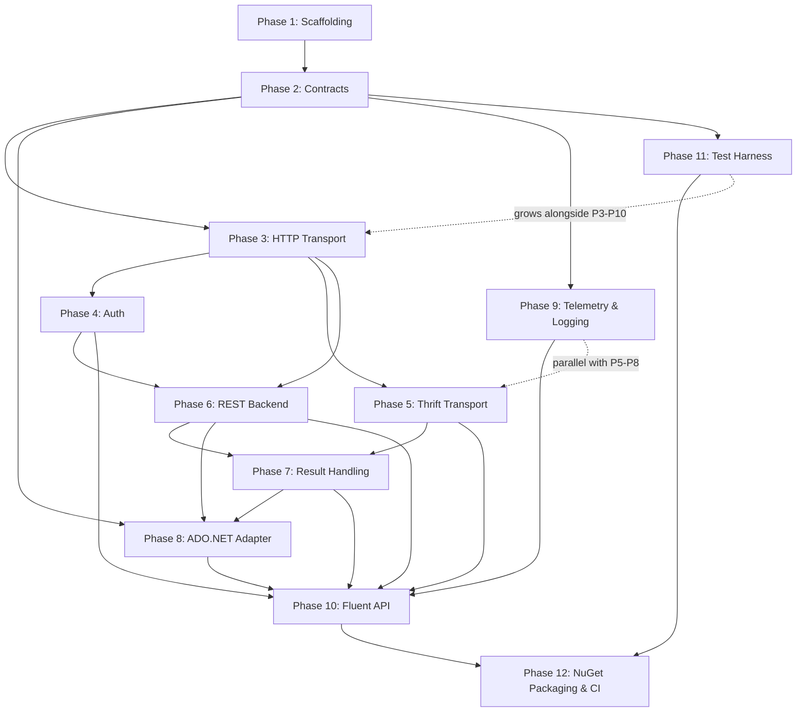

# BricksNet — .NET 10 Implementation Plan

> Output file: `bricksnet/PLAN.md`
> Companion skills: `bricksnet/.github/instructions/*.instructions.md`

## Overview

`BricksNet` is a .NET 10 Databricks SQL client library, NuGet-publishable as **`BricksNet`**. It provides two complementary surfaces over the same core:

1. **A modern fluent async API** — `BricksNetClient → BricksNetSession → BricksNetOperation`, mirroring the Node.js driver (`databricks-sql-nodejs/lib/index.ts`) and adapted to C# `async`/`await` idioms.
2. **A `System.Data.Common`-compliant ADO.NET provider** — `BricksNetConnection`, `BricksNetCommand`, `BricksNetDataReader`, etc. — wrapping the fluent API, enabling Dapper / EF Core (read) compatibility.

The library targets `net10.0` only and exposes two interchangeable backends — **REST** (SQL Exec API) and **Thrift** (TCLIService) — selectable via `BricksNetClientOptions.UseThrift`. It mirrors the Java JDBC driver's dual-protocol design (`IDatabricksClient` → `DatabricksSdkClient` / `DatabricksThriftServiceClient`) and the Node.js three-layer backend abstraction (`IBackend` / `ISessionBackend` / `IOperationBackend`).

### Guiding principles

- **Contracts first.** Every backend and result handler is programmed against an interface defined in Phase 2. Implementations are swappable.
- **Async all the way.** Every I/O method is async, accepts a `CancellationToken`, and uses `ConfigureAwait(false)`.
- **No leaky mutable collections.** Public APIs expose `IReadOnlyList<T>` / `IReadOnlyDictionary<K,V>`, never `List<T>`.
- **Security by default.** TLS is enforced; credentials never appear in logs; cryptographic randomness for all OAuth secrets.
- **Observability without coupling.** `ILogger<T>` and `ActivitySource` only; no `Console` writes; OpenTelemetry-compatible spans.

### Reference implementations

| Concern | Java JDBC (`databricks-jdbc/`) | Node.js (`databricks-sql-nodejs/`) |
|---|---|---|
| Backend abstraction | `IDatabricksClient` + factory | `IBackend` / `ISessionBackend` / `IOperationBackend` |
| Fluent API shape | n/a (JDBC) | `DBSQLClient → DBSQLSession → DBSQLOperation` |
| Result handlers | Arrow / JSON / CloudFetch | `lib/result/{Arrow,Json,CloudFetch}ResultHandler` |
| Auth | `com.databricks.client.auth/` | `lib/connection/auth/` |
| Retry | HTTP 429/503 backoff | `HttpRetryPolicy` jitter backoff |
| Fake service tests | `src/test/.../fakeservice/` | n/a |

When the plan is ambiguous, consult the named reference type in these trees.

---

## Dependency Graph



---

## Phase 1 — Solution Scaffolding & Project Structure

### Goal
Create the `bricksnet/` solution with all projects, shared build configuration, and a CI skeleton so the agent can run `dotnet build` and `dotnet test` successfully against empty projects.

### Input Artefacts
- This plan (`bricksnet/PLAN.md`).
- Target layout from Section B.2 of `docs/opus-prompt.md`.

### Output Artefacts
- `bricksnet/BricksNet.sln`
- `bricksnet/Directory.Build.props`
- `bricksnet/Directory.Packages.props`
- `bricksnet/global.json`
- `bricksnet/.editorconfig`
- `bricksnet/.gitignore`
- `bricksnet/src/BricksNet/BricksNet.csproj`
- `bricksnet/tests/BricksNet.Tests/BricksNet.Tests.csproj`
- `bricksnet/tests/BricksNet.IntegrationTests/BricksNet.IntegrationTests.csproj`
- `bricksnet/.github/workflows/build.yml`

### Implementation Steps
1. Create `global.json` pinning the SDK: `{ "sdk": { "version": "8.0.0", "rollForward": "latestMinor" } }`.
2. Create `Directory.Build.props` at solution root with shared properties:
   ```xml
   <Project>
     <PropertyGroup>
       <TargetFramework>net10.0</TargetFramework>
       <Nullable>enable</Nullable>
       <ImplicitUsings>enable</ImplicitUsings>
       <LangVersion>latest</LangVersion>
       <TreatWarningsAsErrors>true</TreatWarningsAsErrors>
       <AnalysisLevel>latest</AnalysisLevel>
       <EnforceCodeStyleInBuild>true</EnforceCodeStyleInBuild>
       <Deterministic>true</Deterministic>
     </PropertyGroup>
   </Project>
   ```
3. Create `Directory.Packages.props` with `<ManagePackageVersionsCentrally>true</ManagePackageVersionsCentrally>` and the consolidated package versions (see the NuGet table at the end of this plan).
4. Create `.editorconfig` with C# conventions: `dotnet_sort_system_directives_first = true`, `csharp_style_namespace_declarations = file_scoped:warning`, `dotnet_diagnostic.CA2007.severity = warning` (ConfigureAwait), 4-space indent, `end_of_line = lf`.
5. Create `.gitignore` from the standard `dotnet new gitignore` template (`bin/`, `obj/`, `*.user`, `.vs/`, `TestResults/`, `*.nupkg`).
6. Create `src/BricksNet/BricksNet.csproj` (library, `net10.0`) with `GenerateDocumentationFile=true` and package metadata stubs (filled in fully in Phase 12).
7. Create `tests/BricksNet.Tests/BricksNet.Tests.csproj` referencing `xunit`, `xunit.runner.visualstudio`, `Microsoft.NET.Test.Sdk`, `coverlet.collector`, `Moq`, `RichardSzalay.MockHttp`, and a `ProjectReference` to `BricksNet`; set `<IsPackable>false</IsPackable>`.
8. Create `tests/BricksNet.IntegrationTests/BricksNet.IntegrationTests.csproj` referencing the same test packages plus `Microsoft.AspNetCore.Mvc.Testing`; set `<IsPackable>false</IsPackable>`.
9. Create `BricksNet.sln` and add all three projects with `dotnet sln add`.
10. Create `.github/workflows/build.yml`: checkout → `actions/setup-dotnet@v4` (10.0.x) → `dotnet restore` → `dotnet build -c Release --no-restore` → `dotnet test --filter "Category!=E2E"`.

### Key Classes & Interfaces
None (scaffolding only).

### NuGet Dependencies
`xunit`, `xunit.runner.visualstudio`, `Microsoft.NET.Test.Sdk`, `coverlet.collector`, `Moq`, `RichardSzalay.MockHttp`, `Microsoft.AspNetCore.Mvc.Testing`.

### .NET-Specific Considerations
- Central Package Management means project `.csproj` files reference packages **without** `Version=`.
- `TreatWarningsAsErrors=true` is global; suppress `CS1591` only in test projects.

### Verification
- `dotnet build bricksnet/BricksNet.sln -c Release` succeeds.
- `dotnet test bricksnet/BricksNet.sln` reports 0 tests, 0 failures.

---

## Phase 2 — Core Contracts & Interfaces

### Goal
Define all public and internal interfaces and configuration records that later phases implement against. No implementation logic in this phase.

### Input Artefacts
- Phase 1 solution.
- Node.js contracts (`databricks-sql-nodejs/lib/contracts/`) as a structural model.

### Output Artefacts
- `src/BricksNet/Contracts/*.cs` (interfaces)
- `src/BricksNet/Contracts/Options/*.cs` (configuration records)
- `src/BricksNet/Results/ColumnInfo.cs`, `ResultFormat.cs`, `QueryStatus.cs`
- `src/BricksNet/AdoNet/BricksNetConnectionStringBuilder.cs` (type stub; logic in Phase 8)

### Implementation Steps
1. **Fluent API contracts** in `src/BricksNet/Contracts/`:
   - `IBricksNetClient : IAsyncDisposable` — `Task ConnectAsync(CancellationToken)`, `Task<IBricksNetSession> OpenSessionAsync(SessionOptions?, CancellationToken)`, `Task CloseAsync(CancellationToken)`.
   - `IBricksNetSession : IAsyncDisposable` — `ExecuteStatementAsync(string sql, StatementOptions?, CancellationToken)`, `GetCatalogsAsync(...)`, `GetSchemasAsync(...)`, `GetTablesAsync(...)`, `GetColumnsAsync(...)`, `CloseAsync(...)`.
   - `IBricksNetOperation : IAsyncDisposable` — `FetchAllAsync<T>(CancellationToken)`, `FetchChunkAsync<T>(int maxRows, CancellationToken)`, `GetStatusAsync(...)`, `CancelAsync(...)`, `CloseAsync(...)`.
   - `IResultsProvider` — `bool HasMoreRows { get; }`, `Task<IReadOnlyList<IReadOnlyDictionary<string, object?>>> FetchNextChunkAsync(CancellationToken)`.
2. **Backend contracts** (mirror `databricks-sql-nodejs/lib/contracts/`):
   - `IBackend` — `Task<ISessionBackend> OpenSessionAsync(BackendSessionOptions, CancellationToken)`.
   - `ISessionBackend` — `Task<IOperationBackend> ExecuteStatementAsync(...)`, `GetCatalogsAsync(...)`, `GetSchemasAsync(...)`, `GetTablesAsync(...)`, `GetColumnsAsync(...)`, `Task CloseSessionAsync(...)`.
   - `IOperationBackend` — `Task<QueryStatus> GetStatusAsync(...)`, `Task<FetchResult> FetchResultsAsync(FetchOptions)`, `Task CancelAsync(...)`, `Task CloseAsync(...)`.
3. **Auth contracts**:
   - `IAuthProvider` — `Task<string> GetTokenAsync(CancellationToken)`.
   - `ITokenCache` — `Task<string?> TryGetTokenAsync(string key, CancellationToken)`, `Task StoreTokenAsync(string key, string token, DateTimeOffset expiresAt, CancellationToken)`.
4. **Configuration DTOs** (immutable `record` types with `init` properties) in `src/BricksNet/Contracts/Options/`:
   - `BricksNetClientOptions` — `Host`, `Port`, `HttpPath`, `AuthType` (enum `AuthType { Pat, OAuthPkce }`), `UseThrift`, `RetryOptions`, `ProxyOptions?`, `SslOptions`, `TelemetryOptions`.
   - `SessionOptions` — `Catalog`, `Schema`, `QueryTimeoutSeconds`, `MaxRows`, `IReadOnlyDictionary<string,string>? QueryTags`.
   - `StatementOptions : SessionOptions` — adds `IReadOnlyList<BricksNetParameter>? Parameters`.
   - `FetchOptions` — `int MaxRows`, `CancellationToken CancellationToken`.
   - `RetryOptions` — `int MaxAttempts`, `int TimeoutMs`, `int DelayMinMs`, `int DelayMaxMs`.
   - `ProxyOptions` — `Uri Uri`, `ProxyType Type` (`Http`/`Socks5`), `NetworkCredential? Credentials`.
   - `SslOptions` — `bool AllowSelfSignedCerts`, `X509Certificate2Collection? CustomTrustStore`.
   - `TelemetryOptions` — `bool Enabled`, `string DiagnosticListenerName`, `bool SensitiveDataLoggingEnabled`.
5. **Result metadata**:
   - `ColumnInfo` record — `Name`, `TypeName`, `int Ordinal`, `bool IsNullable`, `int? Precision`, `int? Scale`.
   - `ResultFormat` enum — `Arrow`, `JsonColumnar`, `CloudFetch`.
   - `QueryStatus` enum — `Running`, `Succeeded`, `Failed`, `Cancelled`, `Closed`, `Pending`.
6. **ADO.NET contract stub**: declare `BricksNetConnectionStringBuilder : DbConnectionStringBuilder` with typed property signatures (no parse logic yet).

### Key Classes & Interfaces
All listed above. Backend trio (`IBackend`/`ISessionBackend`/`IOperationBackend`) intentionally mirrors `databricks-sql-nodejs/lib/contracts/`.

### NuGet Dependencies
None beyond the BCL (`System.Net`, `System.Security.Cryptography.X509Certificates`).

### .NET-Specific Considerations
- Use `record` for all DTOs; `init`-only properties; nullable annotations on every member.
- `FetchResult` is a small record carrying `ResultFormat`, raw payload (`ReadOnlyMemory<byte>` or `IReadOnlyList<ExternalLink>`), and `IReadOnlyList<ColumnInfo>`.

### Verification
- `dotnet build` succeeds with all interfaces and records compiling.
- No analyzer warnings (CA1812 unused internal types may need `// justification` until Phase 10).

---

## Phase 3 — HTTP Transport Layer

### Goal
Build a robust, DI-friendly HTTP client wrapper that all backends use, with retry, proxy, auth-header injection, and TLS configuration.

### Input Artefacts
- Phase 2 contracts (`IAuthProvider`, `RetryOptions`, `ProxyOptions`, `SslOptions`).
- Node.js retry model (`databricks-sql-nodejs/lib/connection/connections/HttpRetryPolicy.ts`).

### Output Artefacts
- `src/BricksNet/Connection/BricksNetHttpClient.cs`
- `src/BricksNet/Connection/BricksNetHttpClientOptions.cs`
- `src/BricksNet/Connection/Handlers/HttpRetryHandler.cs`
- `src/BricksNet/Connection/Handlers/ProxyConfigHandler.cs`
- `src/BricksNet/Connection/Handlers/AuthHeaderHandler.cs`
- `src/BricksNet/Connection/HttpClientBuilderExtensions.cs`
- `src/BricksNet/Connection/HttpContentExtensions.cs`

### Implementation Steps
1. Create `BricksNetHttpClient` wrapping an `HttpClient` obtained from `IHttpClientFactory`; expose `SendAsync(HttpRequestMessage, CancellationToken)` and typed helpers. The client owns no socket state directly — lifetime is managed by `IHttpClientFactory`.
2. Create `BricksNetHttpClientOptions` — base URL (`https://{Host}:{Port}`), default headers (`User-Agent: BricksNet.dotnet/<assembly-version>`), `TimeSpan Timeout`.
3. Create `HttpRetryHandler : DelegatingHandler`:
   - Retries on HTTP 429 and 503 using exponential backoff with **full jitter**: `delay = Random(0, min(DelayMaxMs, DelayMinMs * 2^attempt))`.
   - Honours the `Retry-After` header when present (seconds or HTTP-date).
   - Caps total elapsed time at `RetryOptions.TimeoutMs` and attempts at `RetryOptions.MaxAttempts`.
   - Logs each retry at `Debug`; logs `Warning` when retries are exhausted.
   - Uses `RandomNumberGenerator`-seeded jitter; never `Thread.Sleep` — use `Task.Delay(delay, cancellationToken)`.
4. Create `ProxyConfigHandler : DelegatingHandler` (or configure the inner `SocketsHttpHandler.Proxy` at registration time): build a `WebProxy` for `Http`; for `Socks5`, configure `SocketsHttpHandler` (which supports `socks5://` proxy URIs natively in .NET 8) — no third-party package required.
5. Create `AuthHeaderHandler : DelegatingHandler`: call `IAuthProvider.GetTokenAsync()` and set `request.Headers.Authorization = new AuthenticationHeaderValue("Bearer", token)`. Never log the token.
6. Create `HttpClientBuilderExtensions.AddBricksNetHttpClient(this IServiceCollection, BricksNetClientOptions)`:
   - Registers a named/typed `HttpClient` via `AddHttpClient`.
   - Configures the primary `SocketsHttpHandler` (proxy + TLS).
   - Chains delegating handlers in order **Proxy → Auth → Retry** (Retry outermost so it re-runs auth on retry).
7. TLS configuration on the primary handler:
   - Default: system trust store, full validation.
   - If `SslOptions.CustomTrustStore` is set, validate against it.
   - If `SslOptions.AllowSelfSignedCerts` is true, log `Warning` and validate chain only (not hostname); add a code comment describing the risk. **Never** unconditionally return `true` from the validation callback.
8. Create `HttpContentExtensions` — `Task<ReadOnlyMemory<byte>> ReadAsArrowAsync(CancellationToken)` (buffers full body to a `MemoryStream`) and `Task<JsonDocument> ReadAsJsonColumnarAsync(CancellationToken)`.

### Key Classes & Interfaces
`BricksNetHttpClient`, `HttpRetryHandler`, `ProxyConfigHandler`, `AuthHeaderHandler`, `HttpClientBuilderExtensions`, `HttpContentExtensions`.

### NuGet Dependencies
`Microsoft.Extensions.Http`, `Microsoft.Extensions.DependencyInjection.Abstractions`, `Microsoft.Extensions.Logging.Abstractions`.

### .NET-Specific Considerations
- .NET 8 `SocketsHttpHandler` supports SOCKS5 proxies natively — no `SocksSharp`/`Yarp` dependency.
- Handlers are resolved per-request by `IHttpClientFactory`; keep them stateless.

### Verification
- `dotnet build` succeeds.
- `dotnet test --filter "FullyQualifiedName~HttpRetryHandlerTests"` (added in Phase 11) passes once tests exist.

---

## Phase 4 — Authentication Providers

### Goal
Implement PAT and OAuth2 Authorization Code + PKCE providers, both implementing `IAuthProvider`. *(Depends on Phase 3.)*

### Input Artefacts
- Phase 2 (`IAuthProvider`, `ITokenCache`), Phase 3 (`BricksNetHttpClient`).
- Node.js auth (`databricks-sql-nodejs/lib/connection/auth/`).

### Output Artefacts
- `src/BricksNet/Auth/PatAuthProvider.cs`
- `src/BricksNet/Auth/OAuthPkceAuthProvider.cs`
- `src/BricksNet/Auth/OAuthTokenCache.cs`
- `src/BricksNet/Auth/CachedTokenProvider.cs`
- `src/BricksNet/Auth/OAuthOptions.cs`, `IOAuthPersistence.cs`
- `src/BricksNet/Auth/AuthProviderFactory.cs`

### Implementation Steps
1. `PatAuthProvider`: constructor takes `string token`; `GetTokenAsync` returns it synchronously via `Task.FromResult`. Any log line referencing the token uses `"***"`.
2. `OAuthPkceAuthProvider` (RFC 7636):
   - `GeneratePkceChallenge()` → `code_verifier` from `RandomNumberGenerator.GetBytes(96)` base64url-encoded; `code_challenge = Base64Url(SHA256.HashData(verifierBytes))`.
   - Generate a CSRF `state` via `RandomNumberGenerator.GetHexString(32)`.
   - Build the authorization URL; open the system browser with `Process.Start(new ProcessStartInfo(url) { UseShellExecute = true })`.
   - Start an `HttpListener` bound to `http://127.0.0.1:{port}/` where port = 8020 with a fallback scan up to 8029; close it immediately after one callback.
   - Validate returned `state` equals the generated `state` before exchanging the code.
   - Exchange code at `OAuthOptions.TokenEndpoint` via HTTP POST through `BricksNetHttpClient`.
3. `OAuthTokenCache : ITokenCache` — in-memory LRU with TTL; pluggable disk persistence via `IOAuthPersistence` (disk persistence uses `IDataProtector`/DPAPI — see Phase 6 security skill).
4. `CachedTokenProvider : IAuthProvider` — wraps any `IAuthProvider`; checks cache first; proactively refreshes when remaining TTL < 30 seconds.
5. `OAuthOptions` record — `ClientId`, `AuthorizationEndpoint`, `TokenEndpoint`, `IReadOnlyList<string> Scopes`, `int RedirectPort`, `IOAuthPersistence? PersistenceProvider`.
6. `AuthProviderFactory.Create(BricksNetClientOptions)` returns `PatAuthProvider` or a `CachedTokenProvider` wrapping `OAuthPkceAuthProvider` based on `AuthType`.

### Key Classes & Interfaces
`PatAuthProvider`, `OAuthPkceAuthProvider`, `OAuthTokenCache`, `CachedTokenProvider`, `AuthProviderFactory`, `OAuthOptions`, `IOAuthPersistence`.

### NuGet Dependencies
None beyond BCL (`System.Security.Cryptography`, `System.Net.HttpListener`, `System.Diagnostics.Process`).

### .NET-Specific Considerations
- Use `Base64Url` helper (custom: replace `+`→`-`, `/`→`_`, strip `=`) or `Microsoft.AspNetCore.WebUtilities.WebEncoders` if already referenced; prefer a private helper to avoid extra deps.
- Use `RandomNumberGenerator` (cryptographic) — never `System.Random`.

### Verification
- `dotnet test --filter "FullyQualifiedName~PatAuthProviderTests|FullyQualifiedName~OAuthPkceAuthProviderTests"` passes (Phase 11).

---

## Phase 5 — Thrift Code Generation & Transport

### Goal
Generate / reference C# Thrift types from `TCLIService.thrift` and build the Thrift-over-HTTP transport. *(Depends on Phase 3.)*

### Input Artefacts
- `TCLIService.thrift` IDL — source from `databricks-sql-nodejs/thrift/` (the `.d.ts`/`.js` already exist there) or `databricks-jdbc/jdbc-core/src/`.
- Phase 3 `BricksNetHttpClient`.

### Output Artefacts
- `src/BricksNet/Backends/Thrift/Generated/*.cs` (generated; `[ExcludeFromCodeCoverage]`)
- `src/BricksNet/Backends/Thrift/ThriftHttpTransport.cs`
- `src/BricksNet/Backends/Thrift/ThriftBackend.cs`
- `src/BricksNet/Backends/Thrift/ThriftSessionBackend.cs`
- `src/BricksNet/Backends/Thrift/ThriftOperationBackend.cs`
- `src/BricksNet/Backends/Thrift/ThriftStatusChecker.cs`

### Implementation Steps
1. Obtain the IDL: copy `TCLIService.thrift` (and its includes) into `src/BricksNet/Backends/Thrift/idl/`.
2. Generate C# types with the Thrift compiler: `thrift --gen netstd:wcf=false -out src/BricksNet/Backends/Thrift/Generated src/BricksNet/Backends/Thrift/idl/TCLIService.thrift`. Document this exact command in the file header. Do not hand-edit generated output.
3. `ThriftHttpTransport : TTransport` — wraps `BricksNetHttpClient`; on flush, POSTs the buffered binary Thrift frame to `https://{Host}{HttpPath}`; reads the full response body into a `MemoryStream` before exposing it for reading (avoids `HttpContent` stream-position issues).
4. `ThriftSessionBackend : ISessionBackend` maps each call to a `TCLIService.Client` async RPC:
   - `OpenSessionAsync` → `TOpenSessionReq`/`TOpenSessionResp`
   - `ExecuteStatementAsync` → `TExecuteStatementReq`/`TExecuteStatementResp`
   - `GetStatusAsync` → `TGetOperationStatusReq`/`TGetOperationStatusResp`
   - `FetchResultsAsync` → `TFetchResultsReq`/`TFetchResultsResp` (orientation `FETCH_NEXT` after first fetch)
   - `CancelAsync` → `TCancelOperationReq`
   - `CloseAsync` → `TCloseOperationReq`
   - `CloseSessionAsync` → `TCloseSessionReq`
5. `ThriftOperationBackend : IOperationBackend` — stores the opaque `TOperationHandle` and replays it on every subsequent RPC.
6. Result-format detection in `FetchResultsAsync`: parse `TRowSet` from `TFetchResultsResp`; `arrowBatches` → `ResultFormat.Arrow`; `columns` → `ResultFormat.JsonColumnar`; `resultLinks` → `ResultFormat.CloudFetch`.
7. `ThriftBackend : IBackend` — factory; owns `TCLIService.Client` and protocol/transport lifetime.
8. `ThriftStatusChecker.EnsureSuccess(TStatus)` — throws `BricksNetException` on `ERROR_STATUS`/`STILL_EXECUTING_STATUS`; maps `statusCode`, `sqlState`, `errorCode`.

### Key Classes & Interfaces
`ThriftHttpTransport`, `ThriftBackend`, `ThriftSessionBackend`, `ThriftOperationBackend`, `ThriftStatusChecker`, generated `TCLIService.Client` + DTOs.

### NuGet Dependencies
`Apache.Thrift` (0.21+).

### .NET-Specific Considerations
- Use the `netstd` Thrift generator target; reference `Thrift.Protocol`/`Thrift.Transport` namespaces.
- All RPCs use async overloads with `CancellationToken` propagation.
- Generated files marked `[ExcludeFromCodeCoverage]` and excluded from analyzers via `<NoWarn>` scoped to `Generated/`.

### Verification
- `dotnet build` compiles generated + transport code.
- `dotnet test --filter "FullyQualifiedName~ThriftBackendIntegrationTests"` passes against the fake service (Phase 11).

---

## Phase 6 — REST / SQL Exec Backend

### Goal
Implement the SQL Exec REST API backend. *(Depends on Phase 3 and Phase 4.)*

### Reference
Databricks SQL Statement Execution API (`https://docs.databricks.com/api/workspace/statementexecution`):
- `POST /api/2.0/sql/statements`
- `GET /api/2.0/sql/statements/{statement_id}`
- `GET /api/2.0/sql/statements/{statement_id}/result/chunks/{chunk_index}`
- `DELETE /api/2.0/sql/statements/{statement_id}`

### Output Artefacts
- `src/BricksNet/Backends/Rest/RestBackend.cs`
- `src/BricksNet/Backends/Rest/RestSessionBackend.cs`
- `src/BricksNet/Backends/Rest/RestOperationBackend.cs`
- `src/BricksNet/Backends/Rest/RestStatementPoller.cs`
- `src/BricksNet/Backends/Rest/SqlExecHttpClient.cs`
- `src/BricksNet/Backends/Rest/Dto/*.cs`

### Implementation Steps
1. Define request/response DTOs in `Backends/Rest/Dto/` using `System.Text.Json` with `JsonNamingPolicy.SnakeCaseLower` (built into .NET 8):
   - `ExecuteStatementRequest`, `ExecuteStatementResponse`
   - `StatementStatus`, `StatementState` enum (`PENDING`, `RUNNING`, `SUCCEEDED`, `FAILED`, `CANCELED`, `CLOSED`)
   - `ResultManifest`, `ResultChunkIndex`, `ExternalLink`
   - `StatementParameterDto` (named parameters: `name`, `value`, `type`)
2. `SqlExecHttpClient` — thin wrapper over `BricksNetHttpClient`; adds the `/api/2.0/sql/statements` path prefix and JSON (de)serialization helpers with shared `JsonSerializerOptions`.
3. `RestSessionBackend : ISessionBackend` — `ExecuteStatementAsync` POSTs `ExecuteStatementRequest` with `disposition=INLINE`, `format=ARROW_STREAM`, `wait_timeout` set from options; returns `RestOperationBackend`.
4. `RestStatementPoller` — polls `GET /statements/{id}` with backoff starting 200 ms, capped at 10 s; honours `CancellationToken`; throws `OperationCanceledException` on cancellation; stops when state is terminal.
5. Direct results: if `ExecuteStatementResponse.Result` (inline chunk) is non-null and state is `SUCCEEDED`, skip polling and use the embedded chunk.
6. `RestOperationBackend : IOperationBackend` — `FetchResultsAsync` returns inline Arrow bytes or, for large results, `ExternalLink[]` (CloudFetch) or fetches by chunk index; `CancelAsync` → `DELETE`; `CloseAsync` is a no-op (REST statements auto-close).
7. `RestBackend : IBackend` — creates `RestSessionBackend` (REST has no explicit session; synthesize a session id and carry `Catalog`/`Schema` as request defaults).

### Key Classes & Interfaces
`RestBackend`, `RestSessionBackend`, `RestOperationBackend`, `RestStatementPoller`, `SqlExecHttpClient`, DTOs.

### NuGet Dependencies
`System.Text.Json` (built into net10.0).

### .NET-Specific Considerations
- Use `JsonSerializerOptions { PropertyNamingPolicy = JsonNamingPolicy.SnakeCaseLower, DefaultIgnoreCondition = WhenWritingNull }`.
- Use a source-generated `JsonSerializerContext` for the DTOs to stay trim/AOT-friendly and avoid reflection.

### Verification
- `dotnet test --filter "FullyQualifiedName~RestBackendIntegrationTests"` passes against the fake REST service (Phase 11).

---

## Phase 7 — Result Handling

### Goal
Parse Arrow / JSON / CloudFetch payloads into row dictionaries. *(Depends on Phase 5 and Phase 6 for raw payload extraction.)*

### Output Artefacts
- `src/BricksNet/Results/ArrowResultHandler.cs`, `ArrowTypeConverter.cs`
- `src/BricksNet/Results/JsonResultHandler.cs`
- `src/BricksNet/Results/CloudFetchResultHandler.cs`
- `src/BricksNet/Results/Lz4Decompressor.cs`
- `src/BricksNet/Results/ResultSlicer.cs`
- `src/BricksNet/Results/ResultHandlerFactory.cs`
- `src/BricksNet/Results/CloudFetchLinkExpiredException.cs`

### Implementation Steps
1. `ArrowResultHandler : IResultsProvider` — reads Arrow IPC via `new ArrowStreamReader(stream)`; loops `await reader.ReadNextRecordBatchAsync()` until `null`; converts each `RecordBatch` to `IReadOnlyList<IReadOnlyDictionary<string, object?>>`; processes one batch at a time to limit memory; disposes each batch.
2. `ArrowTypeConverter` — static mapping table:
   `Int8/16/32/64 → sbyte/short/int/long`, `UInt8/16/32/64 → byte/ushort/uint/ulong`, `Float → float`, `Double → double`, `Utf8/LargeUtf8 → string`, `Date32/Date64 → DateOnly`, `Timestamp → DateTimeOffset`, `Decimal128 → decimal`, `Boolean → bool`, `Binary/LargeBinary → byte[]`, `List → object[]`, `Struct → Dictionary<string,object?>`. Returns `null` for SQL NULLs (`array.IsNull(i)`).
3. `JsonResultHandler : IResultsProvider` — parses Thrift `TRowSet.columns` (columnar JSON arrays); re-assembles into row dictionaries; coerces types using `ColumnInfo`.
4. `CloudFetchResultHandler : IResultsProvider` — receives `IEnumerable<ExternalLink>`; validates expiry (throw `CloudFetchLinkExpiredException` if expired); downloads in parallel with `Parallel.ForEachAsync` and `MaxDegreeOfParallelism = cloudFetchConcurrentDownloads` (default 4); each download streams → optional LZ4-decompress → Arrow parse; orders results by `chunk_index` before returning.
5. `Lz4Decompressor` — wraps `LZ4Stream.Decode(inputStream)` to decompress a `Stream`.
6. `ResultSlicer : IResultsProvider` — wraps any provider and enforces `maxRows` across chunk boundaries.
7. `ResultHandlerFactory.Create(ResultFormat, IReadOnlyList<ColumnInfo>, options)` → returns the right `IResultsProvider`.

### Key Classes & Interfaces
`ArrowResultHandler`, `ArrowTypeConverter`, `JsonResultHandler`, `CloudFetchResultHandler`, `Lz4Decompressor`, `ResultSlicer`, `ResultHandlerFactory`.

### NuGet Dependencies
`Apache.Arrow` (18+), `K4os.Compression.LZ4` (1.3+).

### .NET-Specific Considerations
- `RecordBatch` and `ArrowStreamReader` are `IDisposable`; always `using`.
- `TimestampArray` holds microseconds since epoch; convert carefully (see arrow skill).
- `Decimal128Array.GetValue(i)` already returns `decimal`.

### Verification
- `dotnet test --filter "FullyQualifiedName~ArrowTypeConverterTests|FullyQualifiedName~ArrowResultHandlerTests|FullyQualifiedName~CloudFetchResultHandlerTests"` passes (Phase 11).

---

## Phase 8 — ADO.NET Adapter Layer

### Goal
Wrap the fluent API in standard `System.Data.Common` types. *(Depends on Phases 2, 6, 7.)*

### Output Artefacts
- `src/BricksNet/AdoNet/BricksNetConnection.cs`
- `src/BricksNet/AdoNet/BricksNetCommand.cs`
- `src/BricksNet/AdoNet/BricksNetDataReader.cs`
- `src/BricksNet/AdoNet/BricksNetParameter.cs`, `BricksNetParameterCollection.cs`
- `src/BricksNet/AdoNet/BricksNetException.cs`
- `src/BricksNet/AdoNet/BricksNetConnectionStringBuilder.cs` (full implementation)
- `src/BricksNet/AdoNet/BricksNetProviderFactory.cs`

### Implementation Steps
1. `BricksNetConnection : DbConnection`:
   - Constructors `(string connectionString)` and `(BricksNetClientOptions options)`.
   - `OpenAsync`/`Open` create `IBricksNetClient` (Phase 10), connect, open a session; maintain `ConnectionState`: `Closed → Connecting → Open`; reset to `Closed` on exception.
   - `CloseAsync`/`Close` close session + client → `Closed`.
   - `CreateDbCommand()` → `BricksNetCommand`.
   - `ChangeDatabase(string)` sets `Schema` on the session options.
   - `BeginDbTransaction(...)` throws `NotSupportedException` (Databricks SQL has no multi-statement transactions).
   - `ServerVersion` returns the server info version string.
2. `BricksNetCommand : DbCommand`:
   - `CommandText`, `CommandTimeout` → `StatementOptions.QueryTimeoutSeconds`.
   - `DbParameterCollection` → `BricksNetParameterCollection`.
   - Override `ExecuteDbDataReader`/async → returns `BricksNetDataReader`.
   - `ExecuteNonQuery`/async → executes, discards, returns -1.
   - `ExecuteScalar`/async → first column of first row.
   - `Cancel()` → `operation.CancelAsync().GetAwaiter().GetResult()` with a documented deadlock caveat.
3. `BricksNetDataReader : DbDataReader`:
   - `Read`/`ReadAsync` advance rows pulled from `IResultsProvider`.
   - Implement all `GetXxx(int ordinal)` via `ArrowTypeConverter`.
   - `GetSchemaTable()` returns the standard 24-column `DataTable`.
   - `RecordsAffected` returns -1.
   - Also implement `IAsyncEnumerable<IDataRecord>`.
4. `BricksNetParameter : DbParameter` — `ParameterName`, `Value`, `DbType`, `Direction` (only `Input`; throw `NotSupportedException` otherwise). `BricksNetParameterCollection : DbParameterCollection`.
5. `BricksNetException : DbException` — sets `SqlState`, `ErrorCode` (HTTP/Thrift code), `QueryId`.
6. `BricksNetConnectionStringBuilder : DbConnectionStringBuilder` — typed properties for all options (incl. proxy/SSL); keyword aliases (`Host`/`Server`/`Data Source`); round-trips through `ConnectionString`.
7. `BricksNetProviderFactory : DbProviderFactory` — singleton `Instance`; creates connection/command/parameter/builder.

### Key Classes & Interfaces
`BricksNetConnection`, `BricksNetCommand`, `BricksNetDataReader`, `BricksNetParameter(Collection)`, `BricksNetException`, `BricksNetConnectionStringBuilder`, `BricksNetProviderFactory`.

### NuGet Dependencies
None beyond BCL (`System.Data.Common`).

### .NET-Specific Considerations
- Inherit abstract `Db*` base classes (not `IDb*` interfaces).
- Sync `Open`/`Close` call the async variant via `GetAwaiter().GetResult()`; document the deadlock caveat and steer callers to async.

### Verification
- `dotnet test --filter "FullyQualifiedName~AdoNetIntegrationTests|FullyQualifiedName~BricksNetConnectionStringBuilderTests"` passes (Phase 11).

---

## Phase 9 — Telemetry & Structured Logging

### Goal
Add non-invasive observability via `ActivitySource` and `[LoggerMessage]`. *(Implementable in parallel with Phases 5–8.)*

### Output Artefacts
- `src/BricksNet/Telemetry/BricksNetActivitySource.cs`
- `src/BricksNet/Telemetry/LogMessages.cs`
- `src/BricksNet/Contracts/Options/TelemetryOptions.cs` (already declared Phase 2)

### Implementation Steps
1. `BricksNetActivitySource` — static `ActivitySource` named `"BricksNet"`; helper methods to start spans for connection open/close, statement execute, result fetch, auth token fetch.
2. Set span attributes per OpenTelemetry DB semantic conventions: `db.system="databricks"`, `db.statement` (SQL truncated to 1000 chars, only when `SensitiveDataLoggingEnabled`), `db.name` (`catalog.schema`), `server.address`, `server.port`, `databricks.statement_id`, `databricks.backend` (`rest`/`thrift`).
3. `LogMessages` — `[LoggerMessage]` source-generated methods for each event; define level guidelines in comments:
   - `Trace` per-row/chunk; `Debug` per-statement lifecycle + retries; `Information` connection/session lifecycle; `Warning` retries-exhausted-but-succeeded + deprecated options; `Error` unrecoverable.
   - Never log token values or full SQL at `Information`+.

### Key Classes & Interfaces
`BricksNetActivitySource`, `LogMessages`, `TelemetryOptions`.

### NuGet Dependencies
`Microsoft.Extensions.Logging.Abstractions` (already added Phase 3); `System.Diagnostics.DiagnosticSource` (built-in).

### .NET-Specific Considerations
- `[LoggerMessage]` avoids boxing/allocation on disabled levels; never use interpolated strings in `_logger.Log(...)`.

### Verification
- `dotnet build` succeeds; a smoke test asserts an `Activity` is emitted when an `ActivityListener` is attached.

---

## Phase 10 — Fluent API Implementation (BricksNetClient)

### Goal
Implement the top-level fluent API tying all prior phases together. *(Depends on Phases 2–9.)*

### Output Artefacts
- `src/BricksNet/BricksNetClient.cs`
- `src/BricksNet/BricksNetSession.cs`
- `src/BricksNet/BricksNetOperation.cs`
- `src/BricksNet/Backends/BackendFactory.cs`
- `src/BricksNet/ServiceCollectionExtensions.cs`

### Implementation Steps
1. `BricksNetClient : IBricksNetClient, IAsyncDisposable`:
   - Constructors `(BricksNetClientOptions, ILogger<BricksNetClient>? = null)` and `(BricksNetClientOptions, IHttpClientFactory, ILogger<BricksNetClient>? = null)`.
   - `ConnectAsync` validates options and creates `IBackend` via `BackendFactory`.
   - `OpenSessionAsync(SessionOptions?)` → `BricksNetSession`.
   - `DisposeAsync` closes all sessions and disposes the backend.
2. `BricksNetSession : IBricksNetSession, IAsyncDisposable`:
   - `ExecuteStatementAsync(sql, StatementOptions?)` → `ISessionBackend.ExecuteStatementAsync` → wrap in `BricksNetOperation`.
   - Metadata methods delegate to `ISessionBackend`.
   - `DisposeAsync` cancels in-flight operations and closes the session.
3. `BricksNetOperation : IBricksNetOperation, IAsyncDisposable`:
   - `FetchAllAsync<T>()` accumulates chunks; deserialises to POCO `T` via `JsonSerializer`, or returns row dictionaries when `T` is `IDictionary`.
   - `FetchChunkAsync<T>(int maxRows)` fetches the next chunk only.
   - `GetStatusAsync` → `QueryStatus`; `CancelAsync` → backend; `DisposeAsync` closes the operation on the server.
4. `BackendFactory.Create(BricksNetClientOptions, IHttpClientFactory, ILogger)` → `RestBackend` or `ThriftBackend` based on `UseThrift`.
5. `ServiceCollectionExtensions.AddBricksNet(this IServiceCollection, Action<BricksNetClientOptions>)` — registers `IHttpClientFactory` (via `AddBricksNetHttpClient`), `BricksNetClientOptions`, and `IBricksNetClient`.

### Key Classes & Interfaces
`BricksNetClient`, `BricksNetSession`, `BricksNetOperation`, `BackendFactory`, `ServiceCollectionExtensions`.

### NuGet Dependencies
None beyond those already added.

### .NET-Specific Considerations
- All public async methods take `CancellationToken cancellationToken = default` and `ConfigureAwait(false)`.
- Implement `IAsyncDisposable` on all three; sync `Dispose` only as a documented last resort.

### Verification
- `dotnet build` succeeds.
- An end-to-end fake-service test (Phase 11) runs `client → session → operation.FetchAllAsync` for both backends.

---

## Phase 11 — Test Harness

### Goal
Build a comprehensive test suite mirroring the Java driver's fake-service record/replay pattern. *(Grows alongside Phases 3–10.)*

### Output Artefacts
- `tests/BricksNet.Tests/**/*.cs` (unit tests)
- `tests/BricksNet.IntegrationTests/FakeService/*.cs`
- `tests/BricksNet.IntegrationTests/{RestBackend,ThriftBackend,CloudFetch,AdoNet}IntegrationTests.cs`
- `tests/BricksNet.IntegrationTests/fixtures/**`

### Implementation Steps
1. **Unit tests** (`BricksNet.Tests/`):
   - `HttpRetryHandlerTests` (backoff timing/count via `MockHttpMessageHandler`), `AuthHeaderHandlerTests`, `PatAuthProviderTests`, `OAuthPkceAuthProviderTests`, `ArrowTypeConverterTests` (all 18 mappings), `ArrowResultHandlerTests` (round-trip), `JsonResultHandlerTests`, `CloudFetchResultHandlerTests` (ordering + expiry), `BricksNetConnectionStringBuilderTests` (round-trip), `BackendFactoryTests`, `ResultSlicerTests`.
2. **Fake service** (`BricksNet.IntegrationTests/FakeService/`):
   - `FakeServiceMode` enum (`Record`, `Replay`, `Passthrough`).
   - `FakeHttpServer` — `Microsoft.AspNetCore.TestHost`-based in-process server.
   - `FakeServiceRecorder` — Record mode forwards to a real workspace and saves request/response pairs as JSON fixtures.
   - `FakeServiceReplayer` — Replay mode matches on HTTP method + path (ignore query-param order) + normalized body and returns stored responses.
   - Fixture layout: `fixtures/{service_type}/{test_name}/step-{n}.json` = `{ "request": {...}, "response": {...} }`.
   - `FakeServiceFixture : IAsyncLifetime` — starts/stops `FakeHttpServer`.
   - `IntegrationTestBase` — injects the fixture; provides `CreateClient(FakeServiceMode)`.
3. **Integration suites**: `RestBackendIntegrationTests`, `ThriftBackendIntegrationTests`, `CloudFetchIntegrationTests`, `AdoNetIntegrationTests`.
4. **Fixtures**: `fixtures/rest/execute_select/`, `fixtures/rest/execute_direct_results/`, `fixtures/thrift/execute_select/` (Thrift binary frames base64-encoded in JSON).
5. E2E tests requiring live credentials are decorated `[Trait("Category", "E2E")]` and excluded by default.

### Key Classes & Interfaces
`FakeHttpServer`, `FakeServiceRecorder`, `FakeServiceReplayer`, `FakeServiceFixture`, `IntegrationTestBase`, all `*Tests` classes.

### NuGet Dependencies
`xunit`, `Moq`, `RichardSzalay.MockHttp`, `Microsoft.AspNetCore.Mvc.Testing`, `coverlet.collector`.

### .NET-Specific Considerations
- Use `IClassFixture<FakeServiceFixture>` + `IAsyncLifetime`; reset the per-test step counter in `InitializeAsync`.
- Exclude `Backends/Thrift/Generated/` from coverage.

### Verification
- `dotnet test --filter "Category!=E2E"` runs all unit + replay integration tests green.
- Coverage ≥ 85% line on `src/BricksNet/` (excluding generated Thrift).

---

## Phase 12 — NuGet Packaging & CI

### Goal
Make the library publishable and CI green. *(Depends on all prior phases.)*

### Output Artefacts
- Final `src/BricksNet/BricksNet.csproj` packaging block
- `bricksnet/README.md`
- `bricksnet/CHANGELOG.md`
- `.github/workflows/build.yml` (finalised)
- `.github/workflows/security.yml`

### Implementation Steps
1. Add packaging properties to `BricksNet.csproj`:
   ```xml
   <PackageId>BricksNet</PackageId>
   <Version>0.1.0-alpha</Version>
   <Authors>BricksNet Contributors</Authors>
   <Company>BricksNet</Company>
   <Description>BricksNet — Databricks SQL client library for .NET 10</Description>
   <PackageLicenseExpression>Apache-2.0</PackageLicenseExpression>
   <PackageReadmeFile>README.md</PackageReadmeFile>
   <PackageProjectUrl>https://github.com/your-org/bricksnet</PackageProjectUrl>
   <RepositoryUrl>https://github.com/your-org/bricksnet</RepositoryUrl>
   <RepositoryType>git</RepositoryType>
   <IncludeSymbols>true</IncludeSymbols>
   <SymbolPackageFormat>snupkg</SymbolPackageFormat>
   <Deterministic>true</Deterministic>
   <ContinuousIntegrationBuild Condition="'$(CI)' == 'true'">true</ContinuousIntegrationBuild>
   <EmbedUntrackedSources>true</EmbedUntrackedSources>
   ```
   Add `Microsoft.SourceLink.GitHub` package reference.
2. Write `README.md` (solution root): quick-start for both the fluent API and ADO.NET, connection string format, PAT + OAuth examples, a NuGet badge placeholder.
3. Write `CHANGELOG.md` in Keep-a-Changelog format with an `[Unreleased]` section.
4. Finalise `.github/workflows/build.yml`: trigger on push/PR to `main`; checkout → setup .NET 10 → restore → build → `dotnet test --collect:"XPlat Code Coverage" --filter "Category!=E2E"` → upload coverage to Codecov → `dotnet pack -c Release` (on `main` only).
5. Create `.github/workflows/security.yml`: `dotnet list package --vulnerable --include-transitive` (fail on any) + OWASP `dependency-check/Dependency-Check_Action`.

### Key Classes & Interfaces
None (packaging/CI).

### NuGet Dependencies
`Microsoft.SourceLink.GitHub` (build-time only, `PrivateAssets=all`).

### .NET-Specific Considerations
- Test projects set `<IsPackable>false</IsPackable>`.
- Source Link requires `Deterministic=true` + `EmbedUntrackedSources=true`.

### Verification
- `dotnet pack src/BricksNet -c Release` produces `BricksNet.0.1.0-alpha.nupkg` + `.snupkg`.
- `dotnet list package --vulnerable --include-transitive` reports no vulnerable packages.
- CI workflow runs green on a PR.

---

## Consolidated NuGet Package Table (for `Directory.Packages.props`)

| Package | Version | Used In | Purpose |
|---|---|---|---|
| `Microsoft.Extensions.Http` | 8.0.* | Phase 3 | `IHttpClientFactory` |
| `Microsoft.Extensions.DependencyInjection.Abstractions` | 8.0.* | Phase 3, 10 | DI registration |
| `Microsoft.Extensions.Logging.Abstractions` | 8.0.* | Phase 3, 9 | `ILogger<T>`, `[LoggerMessage]` |
| `System.Diagnostics.DiagnosticSource` | 8.0.* | Phase 9 | `ActivitySource` |
| `Apache.Thrift` | 0.21.* | Phase 5 | Thrift protocol/transport |
| `Apache.Arrow` | 18.* | Phase 7 | Arrow IPC reader |
| `K4os.Compression.LZ4` | 1.3.* | Phase 7 | LZ4 decompression |
| `Microsoft.SourceLink.GitHub` | 8.0.* | Phase 12 | Source Link (PrivateAssets=all) |
| `xunit` | 2.9.* | Phase 11 | Test framework |
| `xunit.runner.visualstudio` | 2.8.* | Phase 11 | Test runner |
| `Microsoft.NET.Test.Sdk` | 17.* | Phase 11 | Test SDK |
| `coverlet.collector` | 6.* | Phase 11 | Coverage |
| `Moq` | 4.20.* | Phase 11 | Mocking |
| `RichardSzalay.MockHttp` | 7.* | Phase 11 | HTTP mocking |
| `Microsoft.AspNetCore.Mvc.Testing` | 8.0.* | Phase 11 | In-process fake service |

> Pin exact patch versions in `Directory.Packages.props`; the `*` above indicates "latest stable in the listed minor band" at implementation time.
