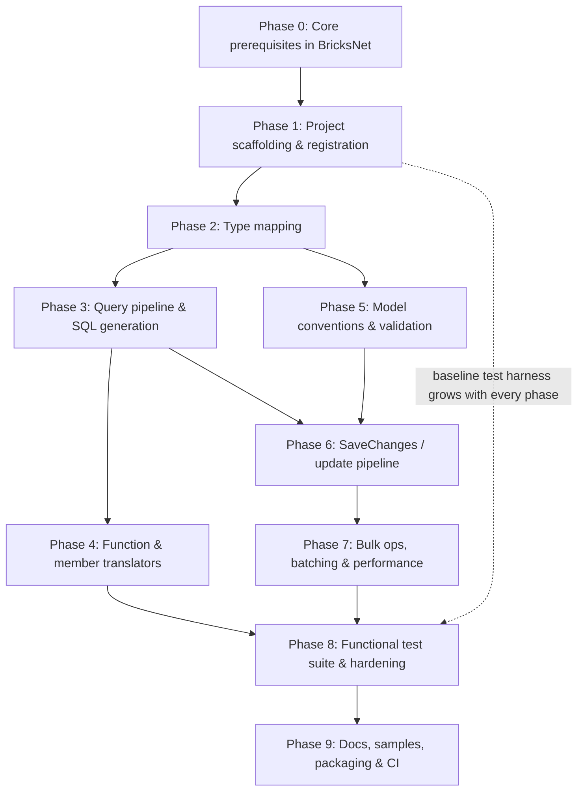

# BricksNet.EntityFrameworkCore — Implementation Plan

> Output file: `docs/EFCORE_PLAN.md`
> Companion plan for the core library: [`PLAN.md`](../PLAN.md)

## Overview

`BricksNet.EntityFrameworkCore` is an **Entity Framework Core 10 relational database provider** for Databricks SQL, built as a separate project and NuGet package on top of the existing BricksNet ADO.NET provider (`BricksNetConnection` / `BricksNetCommand` / `BricksNetDataReader`).

```csharp
services.AddDbContext<SalesContext>(o => o.UseBricksNet(
    "Host=adb-123.azuredatabricks.net;HttpPath=/sql/1.0/warehouses/abc;Token=...;Catalog=main;Schema=sales"));

var top = await db.Orders
    .Where(o => o.OrderDate >= new DateOnly(2026, 1, 1))
    .GroupBy(o => o.Region)
    .Select(g => new { g.Key, Total = g.Sum(o => o.Amount) })
    .OrderByDescending(x => x.Total)
    .Take(10)
    .ToListAsync();
```

### Scope (agreed)

| In scope | Out of scope (future plans) |
|---|---|
| LINQ query translation (read) | Migrations (`dotnet ef migrations`, `database update`) |
| `SaveChanges` INSERT / UPDATE / DELETE on Delta tables | Reverse engineering (`dotnet ef dbcontext scaffold`) |
| `ExecuteUpdate` / `ExecuteDelete` | Spatial types, full-text search |
| Raw SQL (`FromSql`, `SqlQuery`, `ExecuteSql`) | Complex types (`ARRAY`/`MAP`/`STRUCT`) beyond a later, optional phase |
| Optimistic concurrency via rows-affected | Multi-statement transactions (Databricks does not have them) |
| Minimal `EnsureCreated` / `EnsureDeleted` **for tests and dev only** | |

### Decisions taken

1. **Transactions: disable and throw.** The provider defaults `AutoTransactionBehavior` to `Never`, and any explicit `BeginTransaction` / `UseTransaction` throws `NotSupportedException`. The documentation states plainly that `SaveChanges` is **not atomic** across statements.
2. **Core fixes are allowed.** Phase 0 adds small, tested changes to `BricksNet` that EF needs and that also benefit Dapper and other ADO.NET users.
3. **Testing.** CI runs unit tests and SQL-baseline tests (no workspace). Live functional tests against a real SQL warehouse run **locally only**, tagged `Category=E2E`, which the existing CI filter already excludes.
4. **No store-generated keys.** Databricks has no `RETURNING`/`OUTPUT`/`LAST_INSERT_ID`, so the provider requires client-generated key values. Model validation fails fast with a clear message.

### Guiding principles (inherited from `PLAN.md`)

- Async all the way, with `ConfigureAwait(false)` and a `CancellationToken` everywhere.
- Fail loudly and early. An unsupported LINQ construct must throw `InvalidOperationException` at translation time with a Databricks-specific explanation. It must never produce SQL that fails cryptically on the server.
- Security: all values are sent as **named parameters** (`:p0`). Literals are inlined only for constants EF already inlines, and use the Databricks-correct escaping described in Phase 3.
- Mirror EF Core's own providers' structure so contributors can navigate by analogy.

### Reference implementations

| Concern | Reference |
|---|---|
| Overall provider skeleton, minimal feature set | `EFCore.Sqlite` (dotnet/efcore: `src/EFCore.Sqlite.Core`) |
| Backtick identifier quoting, `LIMIT`/`OFFSET` | Pomelo.EntityFrameworkCore.MySql |
| Native boolean, arrays, `IS DISTINCT FROM`, rich function translators | Npgsql.EntityFrameworkCore.PostgreSQL |
| Non-transactional provider behaviour | EF Core Cosmos provider (concepts only) |
| Databricks SQL dialect | Databricks SQL language reference (functions, literals, parameter markers, DML) |

---

## Databricks dialect facts that drive the design

These facts are the reasons behind most of the decisions below. Each one is re-verified against a live warehouse in Phase 3 or Phase 6.

| # | Fact | Consequence |
|---|---|---|
| D1 | No multi-statement transactions; each statement is atomic on its own (Delta). | Decision 1. `SaveChanges` is a sequence of independent commits. |
| D2 | DML returns a **result set** (`num_affected_rows`, `num_inserted_rows`, …), not a DB-level rows-affected count. | Phase 0 surfaces it via `ExecuteNonQuery` / `RecordsAffected`. Phase 6 maps it into EF's rows-affected result set. |
| D3 | No `RETURNING`/`OUTPUT`. Identity columns exist but their values cannot be read back. | Decision 4. |
| D4 | `"double quotes"` are **string literals**, not identifiers. Identifiers use backticks; an embedded `` ` `` is escaped by doubling it. | Custom `ISqlGenerationHelper`. |
| D5 | String literals use **backslash escapes**. `'it''s'` is two adjacent literals, which Spark concatenates into `its`. | Literals must escape `\` → `\\` and `'` → `\'`. This matters for correctness **and injection safety**. |
| D6 | Named parameter markers `:name` are supported (SQL Exec API and Thrift `TSparkParameter`). They cannot be used for identifiers. | `GenerateParameterNamePlaceholder` → `:p0`. |
| D7 | `/` on integers returns `DOUBLE`/`DECIMAL`, not an integer. Integer division is `div`. | Custom binary-operator translation. |
| D8 | ANSI mode is on for SQL warehouses: overflow, divide-by-zero and invalid casts raise errors. | Matches .NET semantics better. Translators must not rely on silent `NULL`. |
| D9 | String comparison is case-sensitive (`UTF8_BINARY`) by default. | Matches C# `==`. Documented; `EF.Functions.ILike` / collation support is optional. |
| D10 | `LIMIT n OFFSET m` is supported (DBR 11.3+). `OFFSET` without `LIMIT` must be verified (`LIMIT ALL OFFSET m`). | Custom `GenerateLimitOffset`. |
| D11 | Correlated subqueries are restricted (e.g. correlated `LIMIT`, and non-equality correlation in some positions). `LATERAL` support depends on the runtime version. | Many EF patterns (`FirstOrDefault` in a projection, `OUTER APPLY`) need detection and a clear error, or a rewrite. |
| D12 | PK/FK constraints are informational (Unity Catalog) and there are no indexes. | Keys are an EF concern only. Uniqueness is not enforced by the server. |
| D13 | Concurrent Delta writers can fail with `DELTA_CONCURRENT_APPEND`, `DELTA_CONCURRENT_DELETE_READ`, `DELTA_METADATA_CHANGED`, etc. | Retrying execution strategy (Phase 6), which needs the error class surfaced by Phase 0. |
| D14 | Each statement is a network round trip, typically 100 ms to seconds. Warehouses may cold-start. | Batching/coalescing (Phase 7), session reuse, generous default timeouts. |
| D15 | Three-part names: `catalog.schema.table`. EF models only `schema.table`. | Default catalog comes from the connection. An optional `HasCatalog()` annotation is added in Phase 5. |

---

## Gap analysis of the current BricksNet ADO.NET layer

Findings from reading `src/BricksNet/AdoNet/*`:

| Gap | Where | Impact on EF |
|---|---|---|
| `ExecuteNonQueryAsync` always returns `-1` | `BricksNetCommand.cs` | `ExecuteDelete`/`ExecuteUpdate` return values are wrong, and concurrency checks are impossible. |
| `RecordsAffected` always `-1` | `BricksNetDataReader.cs` | The same problem on the reader path. |
| `GetFieldValue<T>` falls back to `Convert.ChangeType` | `BricksNetDataReader.cs` | Throws for `DateOnly`, `DateTimeOffset`→`DateTime`, `sbyte`→`byte`, `Guid` from string, `TimeOnly`, enums, etc. EF materialisers call `GetFieldValue<T>` heavily. |
| `TIMESTAMP_NTZ` mapped to `DateTimeOffset` | `ArrowTypeConverter.cs` (`ClrTypeFor`) | NTZ is a wall-clock value and should be `DateTime` (`Kind=Unspecified`). The current mapping gives the wrong CLR type. |
| `DbType` is ignored when building parameters | `BricksNetCommand.BuildParameters` | EF sets `DbType` from type mappings. Without a `DbType`→`TypeHint` mapping, `null` parameters are sent untyped and `DateTime` cannot be told apart from `DATE`. |
| `ServerVersion` is empty | `BricksNetConnection.cs` | Version-gated translation (D10, D11) cannot adapt. |
| No error class on `BricksNetException` (only `SqlState`) | `BricksNetException.cs` | The execution strategy cannot classify Delta concurrency conflicts reliably. |
| `ClientFactory` is a mutable **static** | `BricksNetConnection.cs` | Tests that swap it cannot run in parallel. The EF tests need an instance-level seam. |
| Each `Open()` creates a new client **and** session | `BricksNetConnection.OpenAsync` | EF opens and closes the connection per query, so every query pays session setup. |
| `CreateCommandBuilder` / `CreateDataAdapter` throw ("read-oriented") | `BricksNetProviderFactory.cs` | Not needed by EF. Update the exception message only, since the provider is no longer read-only. |

---

## Target layout

```
src/
  BricksNet/                                   (existing; Phase 0 changes only)
  BricksNet.EntityFrameworkCore/
    BricksNet.EntityFrameworkCore.csproj
    Extensions/
      BricksNetDbContextOptionsBuilderExtensions.cs    UseBricksNet(...)
      BricksNetServiceCollectionExtensions.cs          AddEntityFrameworkBricksNet()
      BricksNetDbFunctionsExtensions.cs                EF.Functions.* (Phase 4)
      BricksNetEntityTypeBuilderExtensions.cs          HasCatalog(...) (Phase 5)
    Infrastructure/
      BricksNetDbContextOptionsBuilder.cs
      Internal/BricksNetOptionsExtension.cs
      Internal/BricksNetModelValidator.cs
      BricksNetRetryingExecutionStrategy.cs
      Internal/BricksNetExecutionStrategy.cs, BricksNetExecutionStrategyFactory.cs
    Diagnostics/Internal/BricksNetLoggingDefinitions.cs
    Metadata/Conventions/BricksNetConventionSetBuilder.cs
    Metadata/Internal/BricksNetAnnotationNames.cs
    Storage/Internal/
      BricksNetRelationalConnection.cs
      BricksNetSqlGenerationHelper.cs
      BricksNetTypeMappingSource.cs
      Mapping/ (one file per type mapping)
      BricksNetDatabaseCreator.cs
      BricksNetTransientExceptionDetector.cs
    Query/Internal/
      BricksNetQuerySqlGenerator(.Factory).cs
      BricksNetQueryableMethodTranslatingExpressionVisitor(.Factory).cs
      BricksNetSqlTranslatingExpressionVisitor(.Factory).cs
      BricksNetSqlExpressionFactory.cs
      BricksNetQueryTranslationPostprocessor(.Factory).cs   (unsupported-shape detection)
      BricksNetParameterBasedSqlProcessor(.Factory).cs
      BricksNetMethodCallTranslatorProvider.cs, BricksNetMemberTranslatorProvider.cs
      Translators/ String, Math, DateTime, DateOnly, DateTimeOffset, Convert, ObjectToString, Guid, ByteArray, Regex(optional)
    Update/Internal/
      BricksNetUpdateSqlGenerator.cs
      BricksNetModificationCommandBatchFactory.cs
      BricksNetModificationCommandBatch.cs
      BricksNetInsertCoalescingBatch.cs (Phase 7)
    Migrations/Internal/
      BricksNetMigrationsSqlGenerator.cs   (CreateTable/DropTable/EnsureSchema only — for EnsureCreated)
      BricksNetHistoryRepository.cs        (throws NotSupportedException)
tests/
  BricksNet.EntityFrameworkCore.Tests/              unit + SQL-baseline (runs in CI)
  BricksNet.EntityFrameworkCore.FunctionalTests/    live warehouse, Category=E2E (local only)
samples/
  BricksNet.Samples/Demos/EfCoreDemo.cs
docs/
  EFCORE.md                                         user guide + limitations
```

Namespaces follow EF provider conventions: public surface in `Microsoft.EntityFrameworkCore` (extension methods only, so `UseBricksNet` is discoverable) and `BricksNet.EntityFrameworkCore.*`. Implementation types live in `*.Internal` namespaces and are `public` but marked with EF's internal-API analyzer convention (`[EntityFrameworkInternal]` style XML docs), as other providers do.

---

## Dependency graph



Each phase ends in a mergeable PR with green CI. Phases 4 and 5 can run in parallel.

---

## Phase 0 — Core prerequisites in `BricksNet`

### Goal
Close the ADO.NET gaps EF depends on, without breaking existing behaviour for fluent-API and Dapper users.

### Implementation steps
1. **Rows affected for DML.**
   - In `BricksNetCommand.ExecuteNonQueryAsync`, after completion, fetch the first row. If the schema contains `num_affected_rows`, return it as `int` (saturating at `int.MaxValue`). Otherwise return `-1` (DDL, `SET`, …).
   - Expose the same value through `BricksNetDataReader.RecordsAffected` when the reader's result set is a DML summary. Keep `-1` for queries, per the ADO.NET convention.
   - Verify the Thrift backend returns the same summary columns. If it reports affected rows elsewhere (e.g. operation status), plumb that through `IBricksNetOperation` as `Task<long?> GetAffectedRowsAsync()`.
2. **Typed `GetFieldValue<T>`.** Replace the `Convert.ChangeType` fallback with an explicit conversion table:
   - `DateOnly` ↔ `DateTime`; `DateTimeOffset` → `DateTime` (UTC); `DateTime` → `DateTimeOffset`
   - `string` → `Guid`; numeric widening/narrowing via checked conversions; `sbyte`↔`byte`
   - `long` → `int` (needed because `COUNT(*)` returns `BIGINT`)
   - enum ← underlying integral type or string; `TimeOnly`/`TimeSpan` ← string (best effort)
   - `byte[]` passthrough; `char` ← single-char string
   - Throw `InvalidCastException` naming the column, the source type and the target type.
3. **`TIMESTAMP_NTZ` → `DateTime`** (`Kind=Unspecified`) in `ArrowTypeConverter` and the JSON result handler. `TIMESTAMP` stays `DateTimeOffset`. Add a CHANGELOG entry, because this is a visible behaviour change.
4. **`DbType` → `TypeHint` mapping** in `BricksNetCommand.BuildParameters`, used when `TypeHint` is null:
   `Boolean→BOOLEAN, Byte/SByte→TINYINT, Int16→SMALLINT, Int32→INT, Int64→BIGINT, Single→FLOAT, Double→DOUBLE, Decimal/Currency→DECIMAL(p,s from Precision/Scale), String/AnsiString*→STRING, Date→DATE, DateTime/DateTime2→TIMESTAMP_NTZ, DateTimeOffset→TIMESTAMP, Binary→BINARY, Guid→STRING`.
   Respect an explicit `TypeHint` first. When `Value` is null, still send the type so `NULL` is typed.
   Track whether `DbType` was explicitly set (as SqlClient does). Otherwise the default `DbType.String` would override value-based inference for every parameter.
5. **`ServerVersion`.** Populate it from the Thrift `OpenSession` protocol/server info, or from a lazily run `SELECT current_version()` (REST). Cache it per connection. Expose a parsed `Version DbrVersion` on `BricksNetConnection` for translators.
6. **Error classification.** Add `string? ErrorClass` to `BricksNetException`, populated from the REST `error_code` and the `[ERROR_CLASS]` prefix of Thrift error messages. Add `bool IsTransient`, true for HTTP 429/503 and the Delta concurrency classes (D13).
7. **Instance-level client factory.** Add a constructor overload `BricksNetConnection(BricksNetClientOptions, Func<…,IBricksNetClient> clientFactory, …)` and keep the static default. This gives EF tests a parallel-safe seam.
8. **Session reuse (light).** Add an opt-in `KeepSessionAlive` connection-string flag. When it is set, `Close()` keeps the client and session cached on the connection object, and `Dispose()` releases them. EF's per-query open/close then costs nothing. Full pooling is deferred to Phase 7.
9. Update the `BricksNetProviderFactory` exception messages to drop "read-oriented".

### Tests
- Extend `BricksNetCommandTests`, `BricksNetDataReaderTests` and `ParameterFormatterTests` (the conversion matrix, rows affected, typed nulls).
- Add `ArrowTypeConverterTests` for NTZ.
- Integration tests (fake service) for the DML summary on both backends.

### Exit criteria
All existing tests pass. Each new behaviour has a test. CHANGELOG updated.

---

## Phase 1 — Project scaffolding & provider registration

### Goal
An empty but functional provider: `UseBricksNet(...)` works, a `DbContext` can run `Database.ExecuteSqlRawAsync` and `Database.SqlQueryRaw<int>`, and the service-provider validation of `EntityFrameworkRelationalServicesBuilder` passes.

### Implementation steps
1. Create `src/BricksNet.EntityFrameworkCore/BricksNet.EntityFrameworkCore.csproj`:
   - Same packaging metadata pattern as `BricksNet.csproj` (PackageId `BricksNet.EntityFrameworkCore`, SourceLink, symbols, README).
   - `ProjectReference` to `BricksNet`.
   - `PackageReference Microsoft.EntityFrameworkCore.Relational`.
   - `InternalsVisibleTo` for the test projects.
2. Add `<PackageVersion Include="Microsoft.EntityFrameworkCore.Relational" Version="10.0.x" />` (latest 10.0 patch, aligned with the `Microsoft.Extensions.*` 10.0.12 line) to `Directory.Packages.props`. Also add `Microsoft.EntityFrameworkCore.Relational.Specification.Tests` for Phase 8.
3. Add both new projects and the test projects to `BricksNet.sln`.
4. **Options**
   - `BricksNetOptionsExtension : RelationalOptionsExtension` (connection string / `DbConnection` / `BricksNetClientOptions` + token, plus provider-specific settings: `DefaultCatalog`, `CommandTimeout` default 300s, `MaxBatchSize`, `InsertCoalescing`, `UseThrift` passthrough).
   - `BricksNetDbContextOptionsBuilder : RelationalDbContextOptionsBuilder<…>`.
   - `UseBricksNet(string connectionString, Action<BricksNetDbContextOptionsBuilder>? opts)`, `UseBricksNet(DbConnection connection, bool contextOwnsConnection = false, …)` and `UseBricksNet(BricksNetClientOptions options, string? accessToken, …)`.
5. **Service registration**: `AddEntityFrameworkBricksNet(IServiceCollection)` using `EntityFrameworkRelationalServicesBuilder`:
   - `IDatabaseProvider` → `DatabaseProvider<BricksNetOptionsExtension>`
   - `LoggingDefinitions` → `BricksNetLoggingDefinitions`
   - `IRelationalConnection` → `BricksNetRelationalConnection`
   - `ISqlGenerationHelper` → `BricksNetSqlGenerationHelper` (Phase 3 completes it)
   - `IRelationalTypeMappingSource` → `BricksNetTypeMappingSource` (minimal in this phase)
   - `IRelationalDatabaseCreator` → `BricksNetDatabaseCreator` (Phase 8 completes it)
   - `IMigrationsSqlGenerator` → `BricksNetMigrationsSqlGenerator` (throws for everything except what Phase 8 adds)
   - `IHistoryRepository` → `BricksNetHistoryRepository` (every member throws `NotSupportedException("Migrations are not supported by the BricksNet EF Core provider")`)
   - `IUpdateSqlGenerator`, `IModificationCommandBatchFactory` (Phase 6)
   - Query factories (Phase 3), the convention set builder (Phase 5), `IModelValidator` (Phase 5), `IExecutionStrategyFactory` (Phase 6)
   - Any migrations-locking service that EF 10 requires to be registered gets a throwing stub. Verify the required-services list against the EF 10 source of `EntityFrameworkRelationalServicesBuilder`.
6. **`BricksNetRelationalConnection : RelationalConnection`**
   - `CreateDbConnection()` → `new BricksNetConnection(ConnectionString)`.
   - Overrides `BeginTransaction*` / `UseTransaction*` / `EnlistTransaction` to throw `NotSupportedException` with guidance (Decision 1).
   - `SupportsAmbientTransactions => false`.
   - Applies `KeepSessionAlive=true` by default, unless the user overrides it.
7. Set the provider default `AutoTransactionBehavior.Never`. Mechanism: provider-specific `IDbContextTransactionManager`/`IRelationalConnection` behaviour, plus overriding `IDatabase`/`RelationalDatabase.SaveChanges` to skip the implicit transaction. Verify which hook EF 10 honours. The fallback is a `BricksNetDatabaseFacadeDependencies` default.
8. **SQL-baseline test harness** in `tests/BricksNet.EntityFrameworkCore.Tests`:
   - A `RecordingBricksNetClient` (built from the existing `FakeFluent` pattern), injected via the Phase 0 instance-level factory. It records SQL text and parameters, and returns scripted rows and schemas.
   - `AssertSql(...)` helper modelled on EF's `TestSqlLoggerFactory` baseline assertions.

### Tests
- Options round-trip, service-provider builds, `ExecuteSqlRaw` sends the expected SQL, transactions throw the documented message.

### Exit criteria
`dotnet build` warning-free (the repo uses `TreatWarningsAsErrors`). The baseline harness works. EF's internal-API usage analyzer warnings (`EF1001`) are suppressed per file with a justification, as other providers do.

---

## Phase 2 — Type mapping

### Goal
Map every supported CLR type to a Databricks store type in both directions, including literal generation, parameter configuration and reader methods.

### Mapping table

| CLR | Default store type | Literal form | Notes |
|---|---|---|---|
| `bool` | `BOOLEAN` | `true`/`false` | |
| `sbyte` | `TINYINT` | `1Y` | `byte` → `SMALLINT` (TINYINT is signed) |
| `short` | `SMALLINT` | `1S` | `ushort` → `INT` |
| `int` | `INT` | `1` | `uint` → `BIGINT` |
| `long` | `BIGINT` | `1L` | `ulong` → `DECIMAL(20,0)` |
| `float` | `FLOAT` | `1.5F` | |
| `double` | `DOUBLE` | `1.5D` | |
| `decimal` | `DECIMAL(p,s)`, default `DECIMAL(18,2)` | `CAST('1.5' AS DECIMAL(p,s))` or `1.5BD` | max precision 38; facets honoured |
| `string` | `STRING` | `'…'` with backslash escaping (D5) | `VARCHAR(n)`/`CHAR(n)` accepted on read; `HasMaxLength` is informational |
| `DateOnly` | `DATE` | `DATE'2026-01-01'` | |
| `DateTime` | `TIMESTAMP_NTZ` | `TIMESTAMP_NTZ'…'` | `Kind` is not preserved, as with SQL Server `datetime2` |
| `DateTimeOffset` | `TIMESTAMP` | `TIMESTAMP'…+00:00'` | stored as a UTC instant; the offset is **not** preserved (documented) |
| `byte[]` | `BINARY` | `X'0A0B'` | |
| `Guid` | `STRING` | `'…'` | client-generated (Decision 4); value converter-based mapping |
| `char` | `STRING` | | |
| `TimeOnly` / `TimeSpan` | `STRING` via value converter (ISO) | | Phase 2 baseline. A native `INTERVAL` mapping is optional, after reader support. |
| enums | underlying type | | EF default behaviour |

### Implementation steps
1. `BricksNetTypeMappingSource : RelationalTypeMappingSource`: `FindMapping` by CLR type and by store type name, parsing `DECIMAL(p,s)`, `VARCHAR(n)`, `CHAR(n)`, aliases (`INTEGER`, `LONG`, `SHORT`, `BYTE`, `REAL`, `NUMERIC`, `DEC`) and case-insensitive names.
2. Per-type mapping classes overriding `GenerateNonNullSqlLiteral`, `ConfigureParameter` (sets `TypeHint` on `BricksNetParameter`, plus `DbType`) and `GetDataReaderMethod` where a typed getter avoids boxing.
3. String literal escaping in a single helper (`BricksNetSqlGenerationHelper.EscapeStringLiteral`), shared by the type mapping and the SQL generator. Fuzz-test it with quotes, backslashes, newlines, unicode and `\u0000`.
4. `DateTimeOffset` literal and parameter: always normalise to UTC to avoid session time-zone ambiguity.

### Tests
- A mapping matrix test (CLR ↔ store type, facets).
- Literal-generation tests, including escaping.
- A round-trip via the fake client.
- Live (E2E): insert and read back every type, including min/max and null values.

---

## Phase 3 — Query pipeline & SQL generation

### Goal
Translate the core LINQ operators correctly: `Where`, `Select`, `OrderBy`/`ThenBy`, `Skip`/`Take`, `First*`/`Single*`, `Any`/`All`/`Contains`, `Count`/`LongCount`/`Sum`/`Min`/`Max`/`Average`, `GroupBy` with aggregates, `Join`/`GroupJoin`/`SelectMany` (cross and left join), `Distinct`, set operations, `Include` (split and single query), owned types, and table splitting.

### Implementation steps
1. **`BricksNetSqlGenerationHelper`**
   - `DelimitIdentifier`: `` `name` `` with `` ` `` → ` `` `.
   - `StatementTerminator`: `""`. The SQL Exec API rejects multiple statements, so the generator never emits batches.
   - `GenerateParameterName(name)` → `name`. `GenerateParameterNamePlaceholder(name)` → `:name`.
   - EF parameter names (e.g. `__p_0`) must be valid Databricks identifiers. Sanitise them if needed.
2. **`BricksNetQuerySqlGenerator : QuerySqlGenerator`**
   - `GenerateLimitOffset`: `LIMIT n [OFFSET m]`. Emit `OFFSET` without `LIMIT` in the form verified for D10.
   - `GenerateTop`: no-op.
   - `VisitSqlBinary`: integer `/` → `div` with a cast back to the operand type (D7); `%` stays. String `+` → `concat(a, b)` (or `||`), with null-propagation semantics that match EF's expectations.
   - `VisitSqlConstant` delegates to the type mapping. Boolean is native, so no `CASE` wrapping is needed (`BoolType` predicates work directly).
   - Null-safe equality: use `<=>` / `IS [NOT] DISTINCT FROM` in `BricksNetSqlNullabilityProcessor` where EF would otherwise expand to `(a = b OR (a IS NULL AND b IS NULL))`. This is an optimisation and can come after correctness.
   - `VisitCrossApply`/`VisitOuterApply`: emit `LATERAL` joins when the server version supports them (see Phase 0 `DbrVersion`). Otherwise throw a translation error.
   - `VisitTable`: emit `` `catalog`.`schema`.`table` `` when a catalog annotation is present (Phase 5).
   - `VisitCollate` (optional): `COLLATE` (DBR 16.1+).
   - `VisitLike`: `LIKE … ESCAPE '\\'`. Databricks' default escape character is `\`, so EF's escaping of `StartsWith` patterns must match.
3. **`BricksNetQueryableMethodTranslatingExpressionVisitor`**
   - Restrict `TranslateSkip`/`TranslateTake` parameterisation: if parameter markers are rejected in `LIMIT`/`OFFSET` (verify against a live warehouse), inline them as constants via `ParameterBasedSqlProcessor`.
   - Primitive collections (`ids.Contains(x)`) → `IN (:p0, :p1, …)` parameter expansion, as SQLite and SQL Server do pre-EF-8. Native `array_contains(:p, x)` with an `ARRAY` parameter is deferred, because the parameter formatter does not support arrays.
4. **`BricksNetQueryTranslationPostprocessor`**: detect shapes Databricks cannot execute (D11) and throw `InvalidOperationException` with clear messages:
   - correlated subqueries containing `LIMIT`/`ORDER BY` (e.g. `FirstOrDefault()` inside a projection),
   - non-equality correlated predicates, where those are known to be unsupported,
   - APPLY on servers without `LATERAL`.
   Each rule is validated against a live warehouse during this phase and recorded in `docs/EFCORE.md`. Rules that turn out to be unnecessary are removed.
5. **Split queries**: verify `AsSplitQuery()` ordering semantics (no stable ordering without `ORDER BY`). Recommend split queries for collection includes in the docs, because Databricks handles large cartesian joins poorly.
6. `BricksNetSqlExpressionFactory`: type-mapping inference fixes, e.g. `COUNT(*)` is `BIGINT`, `Sum(int)` → `BIGINT`, and `Average(int)` → `DOUBLE`. Apply mappings or casts so materialisation gets the CLR type it expects. The Phase 0 conversions provide a second safety net.

### Tests
- SQL-baseline tests for every operator above, with exact SQL strings.
- Live E2E against a small fixed "Blog/Post/Tag" schema created via `EnsureCreated`. If Phase 8 is not ready yet, a SQL setup script stands in.

### Exit criteria
The baseline suite passes. The Blog E2E suite passes locally. The unsupported-shape list is documented.

### Status (implemented)
- Done: `LIMIT`/`OFFSET`, `DIV` integer division, `||` concatenation, `LATERAL` joins for APPLY, and SQL baselines for every operator listed in the goal.
- **Changed from the plan:** `Take`/`Skip` values are always inlined as literals (`BricksNetParameterBasedSqlProcessor`) instead of being sent as parameters. Paging then works whether or not a runtime accepts parameter markers in `LIMIT`. The cost is that EF regenerates SQL per execution for paged queries.
- **Deferred to Phase 8:** step 4 (unsupported-shape detection) and the `<=>` optimisation. Rejecting shapes without live evidence would block queries that newer runtimes accept, so the rules will come from the live checklist below.

### Live verification checklist (run in Phase 8)
| Shape | Generated SQL | Risk |
|---|---|---|
| `Any()`/`All()` as a scalar | `SELECT EXISTS (SELECT 1 …)` | EXISTS in a projection needs a recent runtime |
| `FirstOrDefault()` inside `Select` | correlated scalar subquery with `ORDER BY … LIMIT 1` | correlated subqueries with `LIMIT` may be rejected ("must be aggregated") |
| `Skip(n).FirstOrDefault()` inside `Select` | correlated subquery with `LIMIT 1 OFFSET n` | as above |
| non-equality correlated `SelectMany(...Take(n))` | `CROSS JOIN LATERAL` / `LEFT JOIN LATERAL … ON TRUE` | LATERAL with correlated `LIMIT` support varies by runtime |
| `Skip` without `Take` | `OFFSET n` with no `LIMIT` | confirm standalone `OFFSET` is accepted |
| Typed literals (Phase 2) | `TIMESTAMP_NTZ'…'`, `1.5BD`, `X'…'`, `5Y` | confirm on SQL warehouse and cluster |
| `DateTime.Now`/`UtcNow` (Phase 4) | `localtimestamp()`, `convert_timezone('UTC', localtimestamp())` | needs a recent runtime; compare with LINQ-to-Objects |
| Date arithmetic (Phase 4) | `timestampadd(DAY, 7L, ts)`, `timestampdiff(HOUR, a, b)` | unit keyword syntax; result type for `TIMESTAMP_NTZ` input |
| String functions (Phase 4) | `contains`, `startswith`, `endswith`, `btrim`, `rlike(s, p)` | function forms (not operators) on the target runtime |
| `DateTimeOffset` parts (Phase 4) | `year(ts)` on `TIMESTAMP` | evaluated in the session time zone; matches .NET only when it is UTC |
| `ExecuteDelete`/`ExecuteUpdate` (Phase 7) | `DELETE FROM t AS a …`, `UPDATE t AS a SET …` | confirm the `AS` alias form is accepted in Delta DML |
| `ExecuteUpdate` with joins (Phase 7) | `UPDATE … WHERE EXISTS (correlated subquery)`; `DELETE … WHERE Id IN (subquery with LIMIT)` | Delta's limits on subqueries in DML `WHERE` |
| Multi-row insert (Phase 7) | `INSERT … VALUES (…), (…)` with up to 256 parameters | parameter-count limit of the SQL Statement Execution API and Thrift; `num_affected_rows` equals the row count |
| `DbUpdateConcurrencyException` (Phase 6) | `UPDATE … WHERE Id = :p AND Version = :p` | `num_affected_rows` is 0 when nothing matches |

---

## Phase 4 — Function & member translators

### Goal
Translate common .NET members and methods to Databricks built-ins.

| .NET | Databricks SQL | Notes |
|---|---|---|
| `string.Length` | `char_length(s)` | |
| `ToUpper`/`ToLower` | `upper`/`lower` | |
| `Trim`/`TrimStart`/`TrimEnd` (no args, or one char) | `trim` / `ltrim` / `rtrim` / `trim(BOTH c FROM s)` | |
| `Substring(i[,n])` | `substring(s, i + 1[, n])` | 1-based |
| `IndexOf(x)` | `instr(s, x) - 1` | empty-string edge case → `0` |
| `Contains`/`StartsWith`/`EndsWith` | `contains`/`startswith`/`endswith` (DBR 11+) or `LIKE` with escaping | prefer functions; parameters are safe |
| `Replace` | `replace` | |
| `string.IsNullOrEmpty`/`IsNullOrWhiteSpace` | `s IS NULL OR s = ''` / `trim(s) = ''` | |
| `string.Concat`/`+` | `concat` | |
| `string.Join` (aggregate) | `array_join(collect_list(x), sep)` | ordering is not guaranteed; documented |
| `Math.Abs/Ceiling/Floor/Round/Pow/Sqrt/Exp/Log/Log10/Sign/Max/Min/Truncate` | `abs/ceil/floor/round/pow/sqrt/exp/ln/log10/sign/greatest/least/trunc` | `round` is half-up, unlike .NET's banker's rounding: document it, or translate `Math.Round(x)` only with `MidpointRounding.AwayFromZero` |
| `DateTime.Now/UtcNow/Today` | `current_timestamp()` (+ NTZ cast), `current_date()` | session TZ caveat |
| `.Year/.Month/.Day/.Hour/.Minute/.Second/.DayOfYear/.DayOfWeek/.Date` | `year/month/day/hour/minute/second/dayofyear/dayofweek-1/to_date` | |
| `AddDays/AddMonths/AddYears/AddHours/…` | `timestampadd(UNIT, n, ts)` / `date_add` / `add_months` | |
| `DateOnly.FromDateTime`, `DateOnly` members | `to_date`, `year()` … | |
| `Guid.NewGuid()` | `uuid()` | server-side only in queries |
| `Convert.ToXxx` / `(T)x` | `CAST(x AS T)` | ANSI errors on invalid casts (D8) |
| `object.ToString()` | `CAST(x AS STRING)` | |
| `Regex.IsMatch` | `s RLIKE pattern` | Java regex dialect; documented |
| `EF.Functions.Like` | `LIKE` | |
| `EF.Functions.ILike` (provider-specific) | `ILIKE` | |
| `EF.Functions.DateDiffDay/Month/Year/Hour/…` (provider-specific) | `timestampdiff(UNIT, a, b)` | |

### Implementation steps
1. One `IMethodCallTranslator` / `IMemberTranslator` per area, registered in `BricksNetMethodCallTranslatorProvider` / `BricksNetMemberTranslatorProvider`. Copy the structure of the SQLite translators.
2. Provider-specific `EF.Functions` extensions in `BricksNetDbFunctionsExtensions`. Each one throws on client evaluation, as with other providers.
3. Any translation that needs a runtime newer than DBR 11 consults `DbrVersion` and falls back or throws.

### Tests
- A baseline test per translation.
- Live E2E correctness tests comparing server results with LINQ-to-Objects results over the same seeded data. This catches the off-by-one (`substring`, `instr`) and rounding differences.

### Status (implemented)
- Done: all translations in the table, with SQL baseline tests.
- **Additions beyond the table:**
  - `Regex.IsMatch` with `RegexOptions.IgnoreCase` (constant patterns only);
  - `Math.Truncate` as `CASE`, because Databricks `trunc` is a date function;
  - `byte[].Length` → `length`;
  - `EF.Functions.Greatest`/`Least`.
- **EF 10 routes `Math.Max`/`Min` to `GenerateGreatest`/`GenerateLeast`** on the SQL-translating visitor, not to method translators. `BricksNetSqlTranslatingExpressionVisitor` handles them, and `byte[].Length` too.
- **`string.Join` over an ordered group** is not translated to `collect_list`, because Databricks doesn't guarantee its order. EF falls back to fetching the ordered elements and joining them client-side, which is correct but transfers more rows.
- **Version gating (step 3) is not implemented.** Every function used needs DBR 13.3 LTS or later, the proposed minimum, so there is nothing to gate yet.
- **Not translated** (EF reports a translation error): `TrimStart(char)`/`TrimEnd(char)` (Databricks argument order for these is ambiguous), `Millisecond`, `DateTime.ToString()` (format differs from .NET), and `Math.Round` with `ToZero`/`ToNegativeInfinity`/`ToPositiveInfinity`.

---

## Phase 5 — Model conventions & validation

### Goal
A model building experience that steers users into what Databricks supports and rejects what it does not, at model-build time rather than at runtime.

### Implementation steps
1. **`BricksNetConventionSetBuilder`**
   - Replace `ValueGenerationConvention` behaviour so integer keys are **not** `ValueGenerated.OnAdd` by default (Decision 4). `Guid` keys keep EF's client-side `GuidValueGenerator`. Sequential GUIDs are not useful here, so plain v7 GUIDs (`Guid.CreateVersion7`) are used.
   - The default schema comes from the connection's `Schema` setting unless `HasDefaultSchema` is used.
2. **`BricksNetModelValidator : RelationalModelValidator`** throws for:
   - store-generated keys or properties (`ValueGeneratedOnAdd` with no client generator, `HasDefaultValueSql`, computed columns used for read-back, rowversion/`IsRowVersion`),
   - `UseHiLo`/sequences,
   - unsupported types without a converter.
   It warns (log) for unique indexes (not enforced, D12) and for keys longer than practical.
   **Concurrency tokens:** allowed only as **client-managed** tokens (e.g. a `long Version` incremented in `SaveChanges` or by the user). Document the pattern.
3. **Catalog support (D15)**
   - Annotation `BricksNet:Catalog` at model level (`modelBuilder.HasDefaultCatalog("main")`) and entity level (`entity.ToTable("orders", "sales").HasCatalog("main")`).
   - Used by `VisitTable` (Phase 3), by `UpdateSqlGenerator` (Phase 6) and by the EnsureCreated DDL (Phase 8).
   - Without an annotation, names stay two-part and resolve against the connection's current catalog.
4. **Views and keyless entities**: `ToView`, `HasNoKey` and `ToSqlQuery` work out of the box. Add tests.
5. Provider-specific fluent API extension methods with XML docs.

### Tests
- Model validation tests for each rule.
- Convention tests: `int Id` is not store-generated, and `Guid Id` is client-generated.

### Status (implemented)
- Done: the value-generation convention, version-7 GUID keys (EF 10's default generator still produces v4), every validator rule, and catalogs (`HasDefaultCatalog`, `HasCatalog`, `GetCatalog`).
- Catalogs work through a `BricksNet:Catalog` annotation on relational tables and views, which `VisitTable` reads.
- **Additions beyond the plan:**
  - **`HasDefaultValue` is rejected**, like `HasDefaultValueSql`. EF would expect to read the default back.
  - **Hidden keys are rejected:** a primary key that is a shadow property, not a foreign key and not client-generated. This is the key EF adds to `OwnsMany` collections. Without the check, every owned item would get key `0`.
  - **Decimal precision above 38** is reported before EF's generic "no mapping" error.
  - **The unique-index warning** is a logged event (`BricksNet.UniqueIndexNotEnforced`, event id 300000).
- **EF behaviour, not provider behaviour:** disposing a context after a model-validation failure throws `ObjectDisposedException` when the context *owns an existing* `DbConnection` (`UseBricksNet(connection, contextOwnsConnection: true)`). That hides the validation message. Connection-string configuration is unaffected.
- Step 2 (default schema from the connection) needs no code: unqualified names already resolve against the session's schema.

---

## Phase 6 — SaveChanges / update pipeline

### Goal
Correct INSERT/UPDATE/DELETE through `SaveChanges`, with optimistic concurrency detection and transient-conflict retry.

### Implementation steps
1. **`BricksNetUpdateSqlGenerator : UpdateAndSelectSqlGenerator`** (or `UpdateSqlGenerator`)
   - `INSERT INTO t (cols) VALUES (:p0, …)`, `UPDATE t SET … WHERE key = … [AND token = …]`, `DELETE FROM t WHERE …`.
   - No read-back, because there are no store-generated values (enforced in Phase 5).
   - Rows affected: the DML result set's first column is `num_affected_rows` (D2). Map the command's `ResultSetMapping` to EF's "rows-affected-only" result set (the same mechanism SQL Server uses with `@@ROWCOUNT`), so EF's `AffectedCountModificationCommandBatch` reads it with `GetInt64(0)`. Verify column order on both backends. If the order is not stable, read by column name in a custom batch.
2. **`BricksNetModificationCommandBatchFactory`**: `MaxBatchSize = 1` by default, because the SQL Exec API is one statement per request. Phase 7 adds insert coalescing.
3. **Concurrency**: `UPDATE`/`DELETE` returning 0 rows affected → `DbUpdateConcurrencyException`. Test with a client-managed `Version` token.
4. **Non-atomic SaveChanges semantics** (Decision 1):
   - If command *k* of *n* fails, commands *1..k-1* are already committed. EF entity states reflect this: the entries for succeeded commands are accepted only when `acceptAllChangesOnSuccess` logic allows. Verify EF's behaviour and document it.
   - Log a warning event (`BricksNetEventId.NonAtomicSaveChanges`) when a `SaveChanges` call produces more than one command. It can be suppressed via `ConfigureWarnings`.
5. **Execution strategy**
   - `BricksNetRetryingExecutionStrategy : ExecutionStrategy` with `EnableRetryOnFailure()`. `BricksNetTransientExceptionDetector` uses `BricksNetException.IsTransient` / `ErrorClass` from Phase 0 (Delta conflict classes, 429/503, warehouse starting).
   - Because there are no transactions, a retried multi-command `SaveChanges` could re-apply already committed commands. Retry is therefore **only safe per statement**, or for single-command saves. Implement this by retrying at the batch level, not the whole `SaveChanges`, or by restricting the default strategy to queries plus single-command saves. Record the decision in the docs.
6. **Raw DML**: `ExecuteSql*` returns rows affected (via Phase 0).

### Tests
- Baselines for the generated DML.
- Fake-client tests for rows affected → concurrency exception.
- Live E2E: CRUD round trip; a concurrency conflict between two contexts; a forced Delta conflict (two parallel updates on the same table), retried successfully.

### Status (implemented)
- **DML:** `BricksNetUpdateSqlGenerator` writes catalog-qualified `INSERT`/`UPDATE`/`DELETE`. Every command is mapped as `LastInResultSet | ResultSetWithRowsAffectedOnly`, so EF reads `num_affected_rows` from Databricks' DML summary and raises `DbUpdateConcurrencyException` on a mismatch.
- **One statement per batch** (`SingularModificationCommandBatch`).
- **Non-atomic saves:**
  - `BricksNetEventId.NonAtomicSaveChanges` is a real EF event, so `ConfigureWarnings` can ignore or throw on it. It is logged once per save that runs more than one statement.
  - On failure, the entities of statements that already committed are accepted (marked saved), so calling `SaveChanges` again does not repeat them. The unique-index warning moved onto the same event mechanism (`BricksNetEventId.UniqueIndexNotEnforced`).
- **Retries:**
  - `EnableRetryOnFailure(maxRetryCount, maxRetryDelay)` retries queries through `BricksNetRetryingExecutionStrategy`, and failed `SaveChanges` statements individually inside the batch executor.
  - **Finding:** EF's `ExecutionStrategy` unwraps `DbUpdateException` before calling `ShouldRetryOn`, so type checks cannot exclude `SaveChanges`. The executor instead marks escaping exceptions with an exception `Data` key that the detector honours.
  - **Finding:** EF does not run `ExecuteSql` through the execution strategy. Retrying raw SQL means wrapping it in `Database.CreateExecutionStrategy().ExecuteAsync(...)` (documented).
- Live E2E items remain for Phase 8.

---

## Phase 7 — Bulk operations, batching & performance

### Goal
Make writes and repeated queries practical given per-statement latency (D14).

### Implementation steps
1. **`ExecuteDelete`**: `DELETE FROM t WHERE …`. When EF needs joins, rewrite to `WHERE EXISTS (…)` / `IN (…)` subqueries (Delta supports simple subqueries in `DELETE`'s `WHERE`). Verify, and throw for unsupported shapes.
2. **`ExecuteUpdate`**:
   - single-table: `UPDATE t SET c = expr WHERE …`,
   - multi-table (EF's `UPDATE … FROM` shape): generate `MERGE INTO t USING (subquery) s ON key-match WHEN MATCHED THEN UPDATE SET …`. Throw for shapes MERGE cannot express.
3. **Insert coalescing**: `BricksNetInsertCoalescingBatch` merges consecutive INSERTs into the same table, with identical column sets, into one multi-row `INSERT INTO t (…) VALUES (…), (…), …`. Inserts have no concurrency checks, so the summed `num_affected_rows` is enough. The batch is bounded by a parameter count limit (verify the SQL Exec API limit; start at 256 parameters per statement) and by a statement size limit. On by default, with an option to disable it.
4. **Session reuse / pooling**: if Phase 0's `KeepSessionAlive` is not enough for `AddDbContextPool` scenarios, add a small session pool in `BricksNet`, keyed by connection string. The pool needs idle timeout, max size, and health checks via `SELECT 1` on checkout after idle. It must be opt-in in the core and on by default in EF.
5. **Compiled queries**: verify `EF.CompileAsyncQuery` and the precompiled/NativeAOT query paths have no provider blockers. Document any that do.
6. **Benchmarks** (local, live): a micro benchmark harness under `tests/…FunctionalTests/Perf` measuring SaveChanges of 1/100/1000 rows with and without coalescing, and the query open/close overhead.

### Tests
- Baselines for `ExecuteUpdate`/`ExecuteDelete`/MERGE and coalesced INSERT.
- Live E2E correctness and rows-affected counts.

### Status (implemented)
- **`ExecuteDelete`:** EF's default translation already fits Delta. Complex shapes (navigation filters, `Take`) become `WHERE Id IN (subquery)`.
- **`ExecuteUpdate` with joins:**
  - EF generates PostgreSQL-style `UPDATE … FROM`. `VisitUpdate` rewrites it as `UPDATE … WHERE EXISTS (SELECT 1 FROM … WHERE …)`, with inner-join conditions moved into the `WHERE`.
  - **Changed from the plan:** shapes that take values from another table, or need an outer join, throw with guidance to use `MERGE INTO` via `ExecuteSql`, instead of generating `MERGE`. EF 10 currently fails on the common "set from a navigation" lambda before the provider sees it.
- **Insert coalescing:** `BricksNetModificationCommandBatch` combines consecutive inserts into one table with identical columns into `INSERT … VALUES (…), (…)`.
  - It is capped by `MaxBatchSize` (default 1000 rows; `MaxBatchSize(1)` disables combining) and by 256 parameters per statement.
  - The rows share one `num_affected_rows` check, through `NotLastInResultSet` mappings.
  - A combined insert is one atomic statement, so it does not log the non-atomic warning.
- **Session health (step 4):** a full pool was not needed. `AddDbContextPool` reuses each context's connection and its kept session. Instead, `BricksNetConnection.KeptSessionIdleTimeout` (default 15 min, `KeptSessionIdleTimeoutSeconds` keyword) replaces a kept session idle past the timeout on the next open, so an expired session isn't reused. That is cheaper than a `SELECT 1` health check.
- **Compiled queries** (`EF.CompileAsyncQuery`) work; a test covers them.
- **Benchmarks (step 6)** need a live warehouse and move to Phase 8.

---

## Phase 8 — Functional test suite & hardening

### Goal
Broad behavioural confidence using EF Core's own specification tests, run live against a warehouse, locally.

### Implementation steps
1. **Minimal DDL for tests and dev** (not migrations):
   - `BricksNetMigrationsSqlGenerator` supports only `EnsureSchemaOperation`, `CreateTableOperation` (`CREATE TABLE … (cols) USING DELTA`, with informational `PRIMARY KEY` only when the catalog is Unity Catalog), `DropTableOperation` and `DropSchemaOperation`. Everything else throws.
   - `BricksNetDatabaseCreator`: `Exists` checks for the schema via `SHOW SCHEMAS LIKE`. `HasTables` uses `SHOW TABLES IN`. `Create` → `CREATE SCHEMA IF NOT EXISTS`. `Delete` → `DROP SCHEMA … CASCADE`, guarded so it is never run without an explicit schema.
   - Documented as dev/test only.
2. **`tests/BricksNet.EntityFrameworkCore.FunctionalTests`**
   - References `Microsoft.EntityFrameworkCore.Relational.Specification.Tests`.
   - `BricksNetTestStore : RelationalTestStore`. Each test class gets its own uniquely named schema (`efct_<class>_<hash>`) in a configured catalog. Seeding uses coalesced inserts. Teardown drops the schema.
   - Configuration from environment variables / user secrets (`BRICKSNET_EF_HOST`, `_HTTPPATH`, `_TOKEN`, `_CATALOG`). Tests are **skipped** (not failed) when these are absent. Everything is `[Trait("Category","E2E")]`.
   - Curated spec suites, added incrementally, with known failures marked via overrides that assert the expected `InvalidOperationException`:
     - `BuiltInDataTypesTestBase`, `NorthwindWhereQueryTestBase`, `NorthwindSelectQueryTestBase`, `NorthwindAggregateOperatorsQueryTestBase`, `NorthwindGroupByQueryTestBase`, `NorthwindJoinQueryTestBase`, `NorthwindFunctionsQueryTestBase` (+ string/math/datetime variants), `NorthwindIncludeQueryTestBase`, `NullSemanticsQueryTestBase`, `OptimisticConcurrencyTestBase` (adapted for client tokens), `UpdatesTestBase`, `BulkUpdatesTestBase` subset, `FromSqlQueryTestBase`, `SqlExecutorTestBase`.
   - Northwind is seeded once per run into a persistent schema, reused, and refreshed only when a seed hash changes, because seeding is slow.
3. **Hardening loop**: work through spec failures. Each failure ends in one of three outcomes: (a) a fix, (b) a documented limitation with a clear translation error, or (c) an upstream core fix in `BricksNet`.
4. Both backends: run the curated suite once with `UseThrift=false` (warehouse) and once with `UseThrift=true` (all-purpose cluster), if a cluster is available.

### Exit criteria
The curated suites pass or have documented, asserted limitations. A results summary is committed to `docs/EFCORE.md`.

### Status (implemented; live run pending)
- **Step 1 (DDL):** `EnsureCreated` emits `CREATE SCHEMA IF NOT EXISTS` and `CREATE TABLE … USING DELTA`, keeping `NOT NULL` and comments.
  - There are no PK/FK/unique/check constraints, because they are informational and Unity Catalog-only. Indexes are skipped.
  - Statements run without a transaction, and the generated script separates them with `;`.
  - `CanConnect` is `SELECT 1`. `HasTables` uses `SHOW SCHEMAS`/`SHOW TABLES`.
  - **Changed from the plan:** `EnsureDeleted` drops only the model's tables, never schemas, so it cannot remove tables EF does not own. Migrations remain unsupported.
- **Step 2 — changed from the plan:** the live suite is a purpose-built `tests/BricksNet.EntityFrameworkCore.FunctionalTests` project, not EF's specification tests. Those need provider-specific test stores, fixtures and many overrides, and wiring them up without a workspace to iterate against would produce unverified scaffolding. They can be added once live runs are routine. The suite covers:
  - every item of the live verification checklist (Phases 2–7);
  - ~55 translations, each evaluated by Databricks inside a `WHERE` and compared with .NET;
  - query shapes compared with LINQ-to-Objects over the same seed data;
  - a round trip of every mapped type with edge values;
  - CRUD, a concurrency conflict between two contexts, 300-row multi-row inserts, and `ExecuteUpdate`/`ExecuteDelete` with joins;
  - parallel writers with `EnableRetryOnFailure`;
  - benchmarks (insert throughput with and without combining; session reuse).
- **Isolation:** each run creates a schema named `efct_<timestamp>_<id>` in the configured catalog and drops it (`CASCADE`) at the end. Tests are `Category=E2E` and skip themselves without configuration.
- **Steps 3–4** (hardening loop, both backends) and the `docs/EFCORE.md` results summary need a live run.

### Running the live suite
```powershell
$env:BRICKSNET_EF_HOST     = "adb-<workspace-id>.azuredatabricks.net"
$env:BRICKSNET_EF_HTTPPATH = "/sql/1.0/warehouses/<warehouse-id>"
$env:BRICKSNET_EF_TOKEN    = "<personal access token>"
$env:BRICKSNET_EF_CATALOG  = "<catalog where a temporary schema may be created>"
# Optional, for an all-purpose cluster: $env:BRICKSNET_EF_USETHRIFT = "true"
dotnet test tests/BricksNet.EntityFrameworkCore.FunctionalTests --logger "console;verbosity=detailed"
```
The token needs `USE CATALOG` and `CREATE SCHEMA` on the catalog. Benchmarks print timings and can be run alone with `--filter Category=Benchmark`.

---

## Phase 9 — Docs, samples, packaging & CI

### Implementation steps
1. `docs/EFCORE.md` covers:
   - quick start and connection options,
   - the type-mapping table,
   - a "Differences from SQL Server" section (transactions, keys, case-sensitivity, rounding, timestamps/time zones, latency),
   - supported and unsupported LINQ (from Phases 3 and 8),
   - concurrency patterns, retry and non-atomic SaveChanges guidance,
   - performance tips (`AsNoTracking`, split queries, coalescing, `KeepSessionAlive`, context pooling).
2. README: a short EF Core section linking to `docs/EFCORE.md`.
3. Samples: `samples/BricksNet.Samples/Demos/EfCoreDemo.cs` showing a query, a SaveChanges round trip and `ExecuteUpdate`, wired into the existing samples `Program.cs` menu.
4. Packaging: `BricksNet.EntityFrameworkCore` package with dependencies on `BricksNet` (same version) and EF Core Relational `[10.0, 11.0)`. Version it in lockstep with `BricksNet` (`0.1.0-alpha`).
5. CI:
   - The existing build workflow builds the whole solution, and the new test project runs under the existing `Category!=E2E` filter.
   - The pack step produces both packages.
   - The dependency-check suppressions are reviewed for new EF transitive dependencies.
6. CHANGELOG entries for the core changes (Phase 0) and the new package.

### Status (implemented)
- **Docs:** `docs/EFCORE.md` is the user guide. The README links it and lists the EF provider as a third surface.
- **Sample:** `samples/BricksNet.Samples` has an `EfCore` demo, which needs the new `Databricks:Catalog` setting. It creates and drops `bricksnet_efcore_demo` tables.
- **Packaging:** the nuspec depends on `BricksNet 0.1.0-alpha` and `Microsoft.EntityFrameworkCore.Relational [10.0.12, 11.0.0)`. The range is set in `Directory.Packages.props`, because the provider uses EF internal APIs.
- **CI:** the pack step produces both packages. `dotnet list package --vulnerable` reports no vulnerable packages for any project.
- **Not verified:** the OWASP Dependency-Check job now scans the EF provider too. It needs Java and the NVD database, so it was not run locally; its first CI run may need suppressions reviewed.

---

## Risks & mitigations

| Risk | Likelihood | Mitigation |
|---|---|---|
| Correlated subquery limits make common EF patterns fail (D11) | High | Early live verification in Phase 3, clear translation errors, documentation steering users to split queries and joins |
| EF internal APIs change between 10.x patches | Medium | Pin to `10.0.x`, follow EF provider-writer guidance, keep overrides minimal |
| Non-atomic SaveChanges surprises users | High | Decision 1 (no fake transactions), warning event, prominent docs |
| Per-statement latency makes SaveChanges slow | High | Insert coalescing, `ExecuteUpdate`/`ExecuteDelete`, session reuse, benchmarks |
| Retry re-applies committed commands | Medium | Per-statement retry only (Phase 6, step 5) |
| Live-only verification (no CI workspace) lets regressions slip | Medium | Dense SQL-baseline tests in CI; run the live suite before every release (release checklist item) |
| String literal escaping bug → injection | Low (high impact) | Parameters by default, a single escaping helper, fuzz tests |
| `TIMESTAMP_NTZ` mapping change breaks existing core users | Low | CHANGELOG, still alpha (`0.1.0-alpha`) |

## Remaining open questions (non-blocking; defaults chosen)

1. **Extension method name**: `UseBricksNet(...)` (default, matches the package) vs `UseDatabricks(...)`.
2. **Catalog annotation**: included in Phase 5 by default. It can be dropped if two-part names plus the connection's default catalog are enough.
3. **Insert coalescing default**: on by default (Phase 7). Turn it off if exact per-row error attribution matters more than speed.
4. **Minimum Databricks runtime / warehouse version** to officially support: proposed DBR 13.3 LTS+ / current SQL warehouses (needed for named parameter markers and `OFFSET`).
